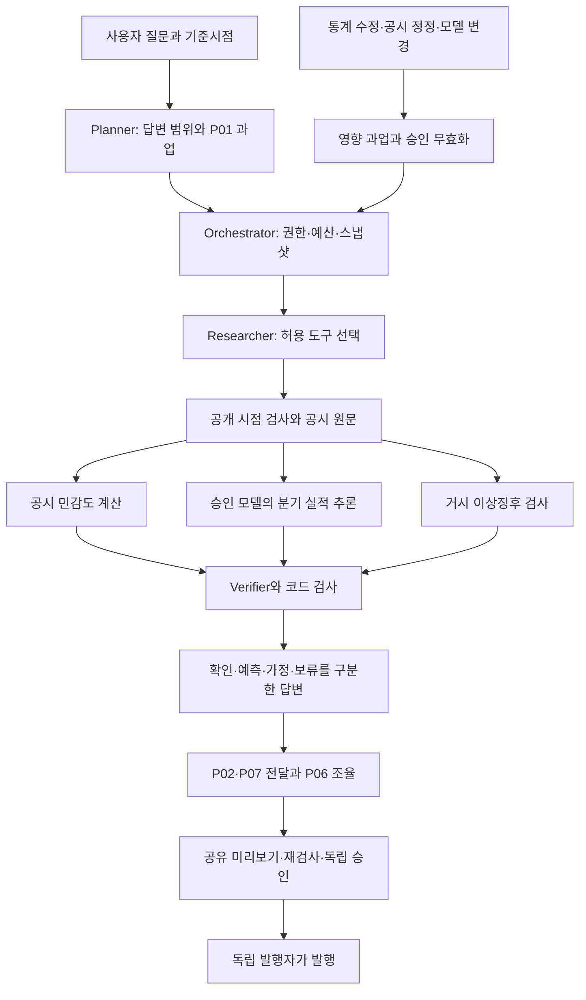

# 모두의 리서치 P01 거시경제 전문분야 상세 개발기획서

**7관점 전문 에이전트와 4대 공통 업무를 연결하는 학습모델 도구 확장 — 01**

- 작성 기준: 2026-10-28, 기획 버전 1.0.
- 문서 성격: 추가 개발 제안. 앱 구현 완료 보고서나 투자 전망 보고서가 아니다.
- 목표: 공개 시점이 확인된 거시·기업 자료로 기업별 거시 노출과 다음 분기 실적의 조건부 예측 범위를 제시하고, 원문·산식·모델·불확실성을 사람이 검토하도록 한다.
- 우선 범위: 삼성전자·SK하이닉스의 연구 화면, 다음 분기 매출 예측부터 검증. 학습용 기업 패널은 별도 확대한다. 영업이익·영업현금흐름은 순차 확장한다.
- 실행 상태: 로컬 기획·명세·일부 소스와 공식 문서를 읽어 작성했다. 이번 작업에서 앱 수정, 기업 분기자료 수집, 인증 API 호출, 모델 학습·평가·배포는 실행하지 않았다.

## 1. 기획의 핵심과 사용자 가치

사용자가 “원/달러 환율이 오르고 금리가 내려가면 삼성전자와 SK하이닉스의 다음 분기 실적을 어떻게 검토해야 하는가?”라고 질문했을 때, 현재 관측값과 일반적인 경제 설명만 나열하면 기업별 차이를 판단하기 어렵다. 반대로 수출기업이라는 이유만으로 이익 증가를 확정하면 수입 원가, 통화별 매출, 해외 생산, 헤지, 차입 조건과 산업 수요를 놓친다.

P01은 이 질문을 다음 네 가지 확인 가능한 업무로 나눈다.

1. **관측:** 어떤 통계가 언제 공개되었고 예측 기준시점에 무엇을 알 수 있었는가.
2. **노출:** 기업이 공시한 외화·금리 위험은 무엇이고 어느 범위까지 수치 계산이 가능한가.
3. **예측:** 기업의 과거 실적과 당시 이용 가능한 거시자료를 함께 사용하면 단순 계절 기준선보다 예측이 개선되는가.
4. **조건부 비교:** 같은 모델·자료에서 특정 거시 경로를 가정하면 결과와 예측 범위가 어떻게 달라지는가.

서비스의 효용은 ‘환율 상승에 따른 확정 이익’을 제시하는 데 있지 않다. 사용자가 원문을 확인하고, 어떤 가정이 결과를 바꾸는지 이해하고, 아직 답할 수 없는 부분을 구분하는 데 있다. 투자 매수·매도나 가격 목표를 자동 결정하지 않는다.

**제안 우선순위:** 먼저 자료 시점·공시 노출·기준선과 검토 기능을 완성하고, 검증된 업무에만 학습모델을 도구로 추가한다. P01 전체를 DL 프로젝트로 바꾸지 않는다.

## 2. 전체 앱의 현재 맥락과 이번 기획의 경계

### 2.1 확인한 앱 계열

| 계열 | 로컬 확인 근거 | 이번 기획과의 관계 |
|---|---|---|
| 7관점 통합 실행 | `modu-research-navigation/docs/integrated-spec.md`, `lib/claims/perspectives.mjs` | P01~P07 역할, 공통 실행 원장, 관찰·보류, 입력별 영향과 재사용 구조 참고 |
| 공동 검토·발행 | `modu-research-navigation/docs/collaboration-spec.md` | 명시적 공유 투영, 원본 재검사, revision/digest, 데이터·위험 별도 승인, 작성자 외 발행 계약 보존 |
| 쉬운 메뉴판 | `modu-research-navigation/README.md`, 3.14.1-menu.1 / 4337 | 공동 검토 기능이 연결된 메뉴 계열. 다른 앱과 저장소가 독립임을 유의 |
| 질문 중심판 | `modu-research-question/README.md`, `docs/question-spec.md`, 3.15.0-question.1 / 4338 | 질문→필수 답변→필요 과업만 실행하는 기본 UX 참고. 새 답변의 공동검토 연결은 미구현 |
| 이전 기반 | 프로젝트 `AGENTS.md`, G0~G4 및 후속 개발 기록 | 원본·스냅샷·해시·영향 추적·예산·승인 계약과 한계 확인 |

**확인 범위:** 문서와 관련 코드 일부를 읽었으며 이번 기획을 위해 운영 서버나 전체 회귀시험을 다시 실행하지 않았다. 각 앱의 기존 시험 수치를 이번 작업의 검증 성과로 재사용하지 않는다.

현재 P01 도구는 저장된 환율·금리·연간 물가의 관찰과 관련 공시 노출 후보 검색이다. 거시 충격과 기업 손익의 검증된 수치 연결, 분기 실적 예측·ML/DL 인과 추정은 현재 기능으로 설명하지 않는다. 원문이 검색되었다는 사실도 기업 손익의 인과효과를 입증하지 않는다.

### 2.2 개발 기준의 선택

**제안:** 질문 중심 UX와 공동 검토 기능을 함께 갖추는 별도 개발판을 만든다. 어느 원본 폴더를 복제할지는 착수 시 동결하되, 질문판에 공동 검토가 이미 붙어 있다고 가정하지 않는다. 별도 DB·쿠키·미사용 포트·출력 경로를 사용하고 원본 보존 해시를 기록한다. 기존 운영 DB 이행은 별도 백업·복제 검증을 거친다.

현재 질문 계약은 미래·인과·지원 밖 지표를 미답변으로 보존한다. 새 P01 기능을 추가할 때에는 허용 기업·지표·분기·모델·데이터 커버리지가 확인된 요청만 예측 과업으로 전환한다. 매출 예측을 지원하지 못하면 영업현금흐름 관찰로 바꾸지 않는다. 7관점 전체 일괄 실행도 강제하지 않는다.

### 2.3 이번 문서의 범위

| 구분 | 포함 | 제외 또는 후속 |
|---|---|---|
| 거시 변수 | 원/달러 환율, 국내 정책금리·별도 시장금리, 국내 물가부터 | 모든 국가·통화·원자재를 한 번에 도입 |
| 기업 | 두 기업 화면 + 동종·연관 제조업 학습 패널 확보 계획 | 두 기업의 짧은 연간자료만으로 일반화 주장 |
| 예측 | 다음 분기 매출, 후속 영업이익·영업현금흐름 | 주가·수익률·매수 신호·목표주가 |
| 시나리오 | 명시된 경로에 대한 조건부 모델 출력·공시 계산 | 금리정책의 순수 인과효과 인증 |
| 이상징후 | 거시 입력 변화·모델 적용 범위 이탈 | 금융위기 발생 확률로 자동 해석 |
| 운영 | 로컬 제한 실증·버전 승인·감사·복원 | 자동 모델 승격·자동 발행·분산 실행 |

## 3. 4대 공통 업무와 P01의 관계

7관점은 전문 업무의 구분이고, 4대 공통 업무는 각 전문 업무를 수행하는 방식이다. P01마다 독립적인 Planner·Researcher·Verifier 모델을 새로 학습할 필요는 없다. 기존 공통 실행 체계 안에 P01의 도구·입출력·검사 규칙을 추가한다.

| 공통 업무 | P01에서 수행할 일 | 필수 산출물 | 금지·차단 조건 |
|---|---|---|---|
| Planner — 계획 | 질문을 기업·기준시점·목표분기·지표·관측/예측/시나리오로 분해하고 자료·도구의 적용 가능성 확인 | `P01Plan`, 필수 답변 항목, 필요한 자료, 완료·보류 조건 | 지원 밖 기업·기간을 다른 대상으로 대체; 자료 부족을 모델 호출로 우회 |
| Researcher — 조사 | 허용된 통계·공시 조회, 분기 정규화, 노출 추출, 승인 모델 추론, 산식 계산 | 관측표·원문 위치·분기 특징·예측·시나리오 결과 | LLM의 자유 생성 수치를 예측값으로 저장; 임의 URL/셸 호출 |
| Verifier — 검증 | 시점·단위·CFS·누적/단독분기·모델 버전·구간·적용 범위·문장 유형 검사 | 항목별 검사, 반례, 보류 사유, 재검토 조건 | 같은 LLM의 자기평가만으로 통계 성능·인과·금융 정확도 인증 |
| Orchestrator — 실행 관리 | 소유권·원장·한도·취소·원자 저장·영향 추적·재사용·공유 통제 | 실행 기록·입력/결과 digest·과업 상태·오류·감사 | 예산 초기화, 불확실 호출 자동 반복, 학습·발행 자동 재실행 |

Orchestrator는 코드다. Planner·Researcher·Verifier의 LLM은 목적과 도구 선택·문장 검토를 담당하며, 수치 예측은 승인된 모델 서비스, 계산은 별도 계산기, 권한과 필수 검사는 서버 코드가 수행한다. 네 공통 역할과 네 명의 공동 검토 계정 역할은 다른 개념이다.



## 4. 사용자와 대표 업무 시나리오

### 4.1 사용자별 목적

| 사용자 | 해결할 문제 | 필요한 답 |
|---|---|---|
| 개인 연구자 | 거시 변화가 기업별로 다르게 해석되는 이유 확인 | 공시 노출·조건부 예측·미확보 항목 비교 |
| 초보 학습자 | ‘환율 상승=수출기업 호재’ 같은 단순 해석 점검 | 쉬운 설명, 반대 경로, 실제 원문과 계산 |
| 팀 작성자 | 거시 분석을 보고서에 재현 가능하게 포함 | 기준시점·입력·모델·산식·결과 버전 |
| 데이터 검토자 | 단위·공개 시점·재무 정의·재현성 확인 | 자료 계보·품질 검사·재계산 결과 |
| 위험 검토자 | 과도한 인과 표현·외삽·구간 과신 점검 | 사용 제한·반론·표현 수정·미답변 |

### 4.2 대표 질문과 완료 기준

| 질문 | 시스템 처리 | 완료 기준 |
|---|---|---|
| “최근 환율과 금리를 알려줘” | 최신 수집 지원 여부부터 확인; 저장본이면 그 기준일을 명시 | 관측·공표·수집일, 변수 정의, 오래됨 표시 |
| “환율에 더 노출된 회사는?” | 외화 위험 공시를 비교하고 비교 가능 범위만 계산 | 통화·자산/부채·헤지·민감도 범위와 미확보 구분 |
| “다음 분기 매출은?” | 승인된 기업·지표·예측시점 조합만 추론 | 기준선, 예측 중앙값·구간, 모델 기준일·적용 상태 |
| “환율 5% 상승, 금리 0.5%p 하락이면?” | 경로·대상 금리·시작일·지속기간 확인 후 조건부 계산 | 동일 자료/모델의 기준·조건부 차이, 외삽·가정 표시 |
| “금리 인하 때문에 얼마나 늘어나는가?” | 조건부 비교와 인과 요청 분리 | 인과 부분 보류, 관측·시나리오의 답 가능한 부분 보존 |
| “새 통계 수정본을 반영해줘” | 수정값의 영향 미리보기 후 새 분석 | 옛 결과 불변, 새 버전·영향 항목·검사·재승인 |

## 5. 분석 결과를 네 종류로 분리하는 계약

| 결과 종류 | 의미 | 근거·계산 | 허용 표현 |
|---|---|---|---|
| 공시 민감도 | 기업이 특정 기준일·가정으로 공개한 금융위험 민감도 | 공시 표·문구와 해당 계산 | “공시된 조건에서 세전손익 영향은 …” |
| 과거 관계 | 표본·시점·모형 조건부 상관·회귀 관계 | 데이터셋·표본·회귀 버전·계수 불확실성 | “해당 표본에서 함께 변화한 관계” |
| 실적 예측 | 기준시점 정보로 미래 정답을 추정 | 승인 모델·입력·평가·예측구간 | “모델의 다음 분기 예측 범위” |
| 시나리오 | 사용자가 정한 거시 경로를 입력한 조건부 출력 | 경로·고정 변수·지원 범위·모델 | “이 경로를 가정한 결과 차이” |

네 결과는 유형 필드와 별도 카드로 저장한다. 공시상 외화 금융상품 평가 민감도를 수출 매출이나 다음 분기 영업이익 변화율로 바꾸지 않는다. ‘시나리오 차이’도 정책의 인과효과로 이름 붙이지 않는다.

**설명용 합성 계산:** 순외화 금융자산이 10억 달러, 기준환율이 달러당 1,300원이고 환율을 5% 올리면 단순 원화 환산 차이는 `10억 × 1,300 × 0.05 = 650억원`이다. 이는 가상의 정적 환산 계산이며 실제 두 기업의 노출·당기손익·현금흐름을 뜻하지 않는다. 헤지·통화·회계 처리·세금·노출 변화를 반영하지 않았고, 이를 매출 예측에 더하지 않는다.

## 6. 기능 구성과 개발 우선순위

| ID | 기능 | 우선도 | 수용 기준 |
|---|---|---|---|
| P01-F01 | 질문과 예측시점 계약 | 필수 | 기업·지표·분기·시나리오 정의 없이는 추론 차단 |
| P01-F02 | 거시 원자료·공표/수정 스냅샷 | 필수 | 과거 이용 가능 여부와 출처·해시 재현 |
| P01-F03 | 기업 분기 재무 정규화 | 필수 | 단독분기·누적·CFS·단위·원문 행 결속 |
| P01-F04 | 공시 노출 지도 | 필수 | 통화·금리·기준일·헤지·범위·미확정 표시 |
| P01-F05 | 계절·회귀 기준선 | 필수 | 동일 잠금평가·입력 시점·구간 비교 |
| P01-F06 | 승인 ML 실적 예측 | 조건부 | 기준선 개선·거시 추가 가치·안전 기준 통과 |
| P01-F07 | 조건부 시나리오 | 조건부 | 경로·공동 제약·외삽 검사·확률 미부여 |
| P01-F08 | 거시 이상징후 | 후속 | 경보 정의·정답·오경보·중복 억제 검증 |
| P01-F09 | P02/P07 전달·P06 조율 | 필수 | 같은 변수·실적을 중복 합산하지 않음 |
| P01-F10 | 변경 영향·공동 검토 | 필수 | 새 결과 결속·검사/승인 무효·재승인 |
| P01-F11 | 관측 실적 도착 후 사후 평가 | 필수 | 최초 발표/정정 평가를 나누고 예측을 덮어쓰지 않음 |
| P01-F12 | DL 후보 비교 | 선택 | 학습곡선·다중 시드·ML 대비 비용 포함 이득 |

예측 승격이 실패해도 F01~F05·F10~F11의 관측·노출·재현 가능한 연구 기능은 독립적으로 납품 가능하다. DL 실험은 이 기능의 출시 전제조건이 아니다.

## 7. 문제 정의: X·Y·예측시점

### 7.1 관측 단위와 정답

- 기본 단위: `기업 i × 목표 회계분기 q × 예측 기준시점 τ × 목표지표 k`.
- 우선 정답: 목표분기의 연결 매출액, KRW 원 단위 원본 보존. 화면에는 억원 등 표시 단위를 명시한다.
- 후속 정답: 연결 영업이익과 영업현금흐름. 영업현금흐름은 매출과 별도 목표이며 운전자본·계절성이 다른 문제로 평가한다.
- 보조 정답: 전년 동기 대비 매출 성장률. 전년 값이 0 또는 매우 작으면 성장률을 보류하고 금액 오차를 평가한다.
- 정답 버전: 최초 공식 발표값과 나중 정정값을 별도로 저장한다. 잠정실적·정기보고서·정정 보고서를 섞지 않는다.

### 7.2 예측시점의 고정

**제안 1차 프로토콜:** 목표분기 시작 직전 마지막 달력일 23:59:59 KST를 기준시점으로 한다. 아직 공표되지 않은 직전 분기 실적은 결측·자료 나이로 표현하고, 이를 미래 값으로 채우지 않는다. 전년 동기 정답도 당시 공개 버전이 존재할 때만 기준선 입력으로 쓴다.

분기 중 갱신 예측과 분기 종료 후 실적 발표 전 추정은 별도 상품·평가군으로 둔다. 예측 시점이 늦은 결과를 조기 예측보다 우수한 모델로 비교하지 않는다. 운영 화면에서 임의 날짜를 요청하면 승인된 기준시점 유형인지 검사한다.

입력은 `X(i,q,τ) = 당시 공개된 재무 이력 + 거시 관측 이력 + 공시 노출 + 산업 통제 + 결측/자료 나이`다. 미래 거시 경로는 당시 알 수 없으므로 관측값과 분리된 시나리오 입력으로 취급한다.

### 7.3 시간 구분

| 시간 | 정의 | 누수 방지 용도 |
|---|---|---|
| 관측 대상 기간 | 경제활동·실적이 발생한 일/월/분기 | 실제 측정 대상 구분 |
| 최초 공표시각 | 제공기관·기업이 최초 공개한 시각 | 당시 알 수 있었는지 검사 |
| 수정 공표시각 | 해당 버전이 공개된 시각 | 과거에 나중 수정본 사용 차단 |
| 제공자 이용가능시각 | API/배포 경로에서 그 버전을 제공한 시각 | 경로 지연 반영 |
| 앱 수신시각 | 앱이 실제 수집한 시각 | 운영 지연·감사 기록 |
| 예측시각·모델 학습시각 | 입력 고정·모델 생성 시각 | 재현 및 배포 후 평가 |

과거 백테스트의 재구성 가능성과 앱이 과거에 실제 수집했다는 주장은 다르다. 과거 빈티지와 공식 공표 증거가 있으면 당시 이용 가능 정보를 재구성했다고 기록할 수 있지만, 오늘 수집한 시각을 과거 수집시각으로 바꾸지 않는다. 공표일만 아는 경우 당일 말 또는 다음날부터 이용 가능한 보수적 규칙을 사전 고정한다.

## 8. 데이터 확보 계획

### 8.1 데이터별 계획

| 데이터 | 1차 확보 경로 | 최소 항목 | 빈도·용도 | 현재 상태와 제약 |
|---|---|---|---|---|
| 환율 | 한국은행 ECOS, 보조 FRED | 통화쌍·방향·관측일·종가/평균 정의·공표/수정 | 일→월/분기 집계 | 기존 저장 관측 존재. 장기 시점 증거·빈티지 미확보 |
| 금리 | ECOS·한국은행 결정/공표 자료 | 정책금리·시장금리 구분·만기·연율·시행일 | 일/월→분기 | 기존 3개월 은행간금리를 정책금리로 대체하지 않음 |
| 물가 | 공식 국내 통계·ECOS | CPI 지수·기준년·전월/전년비·공표/개편 | 월 | 기존 WorldBank 연간 물가를 월자료처럼 복제하지 않음 |
| 기업 재무 | DART 원문·OpenDART/XBRL | 회사·기간·계정·CFS·금액·접수번호·원문 행 | 분기 | 기존 두 연도 연간 수치는 분기 학습셋이 아님 |
| 외화 노출 | 정기보고서 금융위험 주석 | 통화별 금융자산/부채·헤지·충격폭·손익/자본 | 분기/반기/연간 | 자동 숫자 추출은 검토 후 채택 |
| 금리 노출 | 차입·금융위험 주석 | 고정/변동금리·차입금·만기·민감도 | 분기/연간 | 계약별 전가·헤지 미확보면 부분 보류 |
| 해외·수출 구조 | 사업/지역 정보·주석 | 해외매출·수출·통화별 결제·생산지 구분 | 분기/연간 | 해외매출 비중은 달러 순노출의 대체값이 아님 |
| 산업 통제 | 공신력 있는 산업·무역 통계 | 수요·가격·수출·재고의 정의와 공개시각 | 월/분기 | P02 협의·권리 확인 후 추가 |

OpenDART 공식 가이드는 단일회사 전체 재무제표에 사업연도·보고서 코드·연결 구분을 사용하고 2015년 이후 정보를 안내한다. 이 사실만으로 모든 기업의 모든 분기 계정과 정정 빈티지가 확보된다고 가정하지 않는다. [OpenDART 단일회사 전체 재무제표](https://opendart.fss.or.kr/guide/detail.do?apiGrpCd=DS003&apiId=2019020)

한국은행의 통계 안내는 ECOS와 공표일정으로 연결된다. 이번 조사에서 ECOS API 페이지의 상세 본문은 웹 도구로 추출되지 않았으므로 계열별 코드·수정본 제공·과거 공표시각 지원은 착수 단계에서 확인해야 한다. [한국은행 경제통계](https://www.bok.or.kr/portal/submain/submain/sts.do?menuNo=200094&viewType=SUBMAIN), [ECOS Open API](https://ecos.bok.or.kr/api/)

FRED의 기본 조회는 현재 알려진 과거 정보이며, ALFRED의 실시간 기간 매개변수는 과거 시점의 정보 조회를 지원한다. 필요한 국내 계열마다 과거 버전 커버리지가 있는지 별도로 확인한다. [FRED Real-Time Periods](https://fred.stlouisfed.org/docs/api/fred/realtime_period.html)

### 8.2 규모와 데이터 단계

**탐색 목표, 확보 결과 아님:** 2015년 이후 중에서 정의·공시·빈티지가 연결되는 8~10년, 30~80개 제조업 기업을 조사한다. 50개 기업×40분기는 명목상 2,000행이지만 환율·금리는 같은 분기에 기업 간 공유되므로 독립적인 거시 충격 관측이 2,000개인 것은 아니다. 실제 독립 시간축은 약 40분기이며 중복 예측시점도 독립 정답을 늘리지 않는다.

| 단계 | 진입 데이터 | 허용 성과 주장 |
|---|---|---|
| D0 계약 개발 | 합성 자료·두 기업 기존 원문 | UI·파서·권한·계산 계약만 검증 |
| D1 관계 탐색 | 정의가 맞는 장기 분기 패널, 빈티지 일부 부족 가능 | 사후 관계 탐색. 당시 가능 예측 성능 주장 금지 |
| D2 과거 시점 평가 | 입력 공표 증거·버전·정답 최초 발표가 재구성됨 | 해당 커버리지의 시간 분리 예측 평가 |
| D3 전향 실증 | 실제 날짜에 동결한 예측과 이후 실적 | 제한된 기업·기간의 운영·업무효과 평가 |

상장폐지·합병·적자 기업을 현재 목록에서 일괄 제외하면 생존 편향이 생긴다. 과거 시점의 분석 대상 목록과 제외 사유를 남긴다. 표본 확대가 삼성전자·SK하이닉스의 사업 특성을 자동 설명하지 않으므로 산업별·규모별·두 대상 기업별 결과를 따로 낸다.

### 8.3 권리·접근·비용

공식 공개자료라도 API 이용조건, 재배포, 원문 저장, 파생 특징·모델 학습·공동 공유 가능 범위를 항목별로 기록한다. API 키는 서버 비밀 설정으로 관리하고 브라우저·프롬프트·로그·압축본에 넣지 않는다. FnGuide 등 유료자료는 실제 계약 권리와 가격 확인 전 기본 의존성으로 두지 않는다. 제공자 호출 제한은 착수 시 공식 문서로 확인해 큐·캐시·429 대기·지수 백오프에 반영한다.

지정 팀 Drive 폴더는 이번 조회에서 항목이 반환되지 않았다. 원래 폴더가 비어 있거나 접근 범위 때문에 보이지 않는지 판별할 수 없어, 로컬 기준자료와 현재 대화를 근거로 사용했다. 팀 인력·유료 계약·GPU·확정 예산을 확보 사실로 쓰지 않는다.

## 9. 재무·거시 데이터 정규화와 품질 검사

### 9.1 누적 재무를 단독분기로 변환

손익·현금흐름의 표시 성격을 확인한 뒤, 동일 회계연도·CFS·통화·단위·계정 정의·일관된 버전 계열에 대해서만 다음 차감식을 사용한다.

```text
Q1 = 1분기 누적
Q2 = 반기 누적 - 1분기 누적
Q3 = 9개월 누적 - 반기 누적
Q4 = 연간 누적 - 9개월 누적
```

이미 3개월 단독 값인 열을 다시 차감하지 않는다. 재무상태표의 기말 잔액은 이 방식으로 분기 현금흐름으로 변환하지 않는다. `thstrm_amount` 등 필드명만 보고 모든 보고서·재무제표를 같은 기간으로 처리하지 않고, 기간 라벨과 계정·재무제표 종류를 함께 읽는다.

정정으로 상반기·연간이 다른 기준이면 자동 차감을 보류한다. Q4는 연간 공표 전 입력으로 존재할 수 없다. 모든 파생값에 사용한 원문 두 행·접수번호·기간·버전·차감식을 저장한다. 결과 합계 일치는 필요한 검사지만 의미가 맞다는 충분조건은 아니다.

### 9.2 거시 변수 변환

- 환율은 `KRW per USD` 방향을 고정하고 평균·기말·변동률·변동성을 구분한다. 원화 절하와 숫자 상승의 관계를 명시한다.
- 금리 수준은 연율 %로, 차이는 %p로 표현한다. `-0.5%p = -50bp`와 금리 수준의 상대변화 `-0.5%`를 구분한다.
- CPI 지수 수준, 전년 동월비, 전기비를 별도 계열로 둔다. 연간 인플레이션을 분기 값 네 개로 복제해 새로운 관측으로 만들지 않는다.
- 일별 환율 집계는 관측 가능한 영업일만 쓰고 휴일·누락·부분월/부분분기를 표시한다. 거래일·달력일 가중 선택을 버전으로 고정한다.
- 자료가 아직 미공표면 이후 값으로 역방향 보간하지 않는다. 마지막 공개값과 자료 나이, 결측 마스크를 사용하거나 해당 과업을 보류한다.

### 9.3 차단 검사

| 검사 | 처리 |
|---|---|
| 입력 버전의 이용가능시각 > 예측시점 | 누수 오류, 해당 입력으로 추론/평가 금지 |
| 빈티지 증거 없음 | D2 제외; D1에서 사후 탐색 상태로 표시 |
| CFS/OFS·회계기간·통화·단위 혼합 | 비교/차감 차단, 자료 보완 요청 |
| 계정 정의 변경·합병·사업분할 | 연결 이력 검토, 불일치 구간 분리 |
| 과도한 결측·오래된 핵심 변수 | 승인 정책에 따라 보류 또는 기준선만 표시 |
| 동일 통계의 중복 제공자 값 | 우선 공급원 유지, 불일치는 충돌로 표시 |
| 데이터 변조·참조 원문 누락 | 검사 실패, 발행 차단 |
| 통계 개편·기준년 변경 | 비교 가능 변환표와 새 데이터 버전 필요 |

## 10. 학습모델 접근법과 선정 원칙

### 10.1 모델을 업무별로 분리

| 업무 | 기준선 | ML 후보 | DL 후보 | 선택 조건 |
|---|---|---|---|---|
| 다음 분기 매출 | 전년 동기 유지·최근 이용가능 추세·계절 평균 | Ridge/Elastic Net, 제한된 깊이의 부스팅 | 소형 TCN 또는 TFT 중 1개 | 기준선·ML의 한계를 오류 분석으로 확인 |
| 영업이익·CFO | 계절 금액·고정 마진/비율 가정 | 별도 회귀·분위수 회귀 | 매출 실험 후 다중목표 후보 | 부호 변화·목표 간 일관성 평가 |
| 거시 이상징후 | 훈련 구간의 robust z-score·변화율 기준 | Isolation Forest 등 | 초기 제외 | 경보 라벨·오경보 비용이 먼저 정의됨 |
| 공시 노출 추출 | 표 파서·규칙·단위 검사 | 제한된 추출/검토 보조 | 필요할 때만 비교 | 핵심 숫자는 원문 대조 후 채택 |

일반적인 실적 모델과 **거시 추가 가치**는 별도다. 재무 이력만으로 잘 예측하는 모델을 만들었더라도 거시 특징을 넣은 이득이 없으면 ‘거시 영향 예측 개선’으로 발표하지 않는다. RAG는 노출·가정 원문을 찾는 수단이며 분기 예측모델의 학습을 대신하지 않는다.

### 10.2 기준선·ML의 구체화

1. B0 전년 동기 유지: 이용 가능하고 비교 가능한 `Y(i,q-4)`를 예측한다.
2. B1 계절/추세 기준선: 최근 공개 이력에서 계절 평균 또는 계절 변화 추정. 선택 규칙은 검증에서 고정한다.
3. B2 재무 전용 규제 회귀: 이용가능 시차 실적·계절·자료 나이·산업 특성. 거시 없이 비교한다.
4. M1 거시 추가 규제 회귀: B2 + 공개된 환율/금리/물가의 수준·변화·시차 및 제한된 노출 상호작용.
5. M2 부스팅: 동일 정보 집합으로 비선형·상호작용을 제한적으로 학습한다. 트리 깊이·최소 잎 표본·탐색 횟수 상한을 둔다.

매출 양수 자료에는 로그 매출 또는 로그 성장 변환을 검토한다. 원화 금액 복원 시 역변환 편향을 훈련 자료로 추정하고 원 단위 오차도 보고한다. 영업이익·CFO에는 음수가 가능하므로 단순 로그를 쓰지 않는다. 변환·표준화·결측 대체·계정 매핑 통계는 매 훈련 fold 안에서만 적합한다.

선형 모형의 한 예는 다음과 같다.

```text
g(i,q) = 기업/산업 효과 + 계절 효과
       + 공개 실적 시차의 계수 합
       + 공개 거시 변화 시차의 계수 합
       + (노출 × 거시 변화)의 제한된 상호작용
       + 오차

학습 목적 = 시간 기준 훈련 오차 + 규제항
```

이 회귀의 거시 계수는 산업 수요·정책 대응·가격 결정 등 누락변수와 역인과의 영향을 받을 수 있다. 인과효과 계수라고 부르지 않는다. 새로운 기업에 대한 일반화 실험에서는 기업 ID 효과를 학습한 성과와 미관측 기업 성과를 분리한다.

### 10.3 DL 비교의 진입 조건

TFT는 정적 특징, 과거 관측 입력, 미래에 알려진 입력과 다중 시점 출력을 다루는 후보 구조다. 이 논문의 존재나 다른 데이터셋 성과는 현재 기업 재무 예측에서의 우수성을 보증하지 않는다. [TFT 원논문](https://arxiv.org/abs/1912.09363)

DL은 다음 조건을 모두 충족한 뒤 소형 모델 한 개부터 비교한다.

- 분기·기업별 충분한 완결 이력과 시점 증거가 있고 결측/개편 비율이 관리된다.
- 20·30·40분기 등의 학습곡선에서 시간축 증가가 검증 성능에 도움이 되는지 확인한다. 단순 기업 수만으로 판단하지 않는다.
- 거시 입력 추가 가치가 ML에서 확인되거나 ML 오류에서 검증 가능한 긴 시차 구조 가설이 나온다.
- 미래 입력에는 달력·이미 공표된 일정 또는 명시적 시나리오만 넣는다. 미래 실현 금리·환율은 넣지 않는다.
- 같은 데이터·기준시점·전처리·탐색 예산에서 최소 3개 시드로 비교하고 지연·메모리·운영비를 함께 보고한다.

조건이 충족되지 않으면 DL은 미실행 또는 중단 상태로 유지한다. 로컬 Qwen의 역할별 호출과 별도의 실적 예측모델 학습을 구별한다.

## 11. 예측구간과 불확실성

기본 출력은 중앙 추정값과 80% 예측구간이다. 95% 구간은 평가 가능한 표본이 있을 때 보조로 제공한다. 구간 수준은 제안이며 실제 포함률을 확인하기 전 ‘검증된 80% 구간’으로 표시하지 않는다.

- 계절 기준선도 과거 예측 잔차로 구간을 구성해 점예측만 비교하는 불공정을 피한다.
- 분위수 회귀에는 `ρu(e) = max(u·e, (u-1)·e)`의 pinball loss를 사용한다. 하위/상위 분위수 역전은 별도 검사한다.
- 시간 순서의 별도 보정 구간을 사용하고 임의 셔플 보정은 하지 않는다. 구조 변화가 있는 금융 시계열에서 교환가능성을 전제로 하는 구간 보장을 무조건 주장하지 않는다.
- 시간축과 기업 간 의존성을 고려한 블록 평가를 사용한다. 여러 기업에 같은 충격이 온 결과를 독립 표본처럼 세지 않는다.

불확실성은 최소 네 가지로 나누어 표시한다: 자료 시점/품질 부족, 통계적 예측 오차, 미래 거시 경로 미확정, 모델 적용 범위 밖 변화. 넓은 구간은 잘 보정되었다는 뜻이 아니며 너무 좁은 구간도 정확성의 증거가 아니다.

거시 경로를 고정한 조건부 구간에는 그 경로 자체가 틀릴 불확실성이 포함되지 않는다. 시나리오 3개의 최저·최고를 합쳐 확률구간이라고 표시하지 않는다.

## 12. 거시 시나리오 엔진

### 12.1 시나리오 계약

`ScenarioSpec`에는 기준시점, 목표분기, 변수·단위, 시작 수준, 변화 방식, 월별 경로, 적용 기간, 고정 변수, 사용자/시스템 생성 여부, 근거, 시나리오 해시를 저장한다.

“환율 5% 상승”은 기말 한 번 상승인지 분기 내내 5% 높은 평균인지 다르다. “금리 인하”도 정책금리·은행간금리·기업 차입금리 중 무엇인지 구분한다. 정책금리 변화가 기업 차입금리에 즉시 1:1 전달된다고 가정하지 않는다.

기본 경로는 예측시점 마지막 공개 수준 유지, 대안 경로는 사용자 명시 조건으로 시작한다. 기본 경로도 미래 실현값 예측으로 포장하지 않는다. 자동 거시 경로모델은 별도 평가 없이는 추가하지 않는다.

### 12.2 계산 절차

1. 기준 입력·노출·학습모델 버전을 고정한다.
2. 기준 경로와 대안 경로의 변수 단위·시간을 맞춘다.
3. 학습 범위·조합의 희소성·경제적 제약을 검사한다.
4. 각각의 점·구간 출력과 차이를 계산한다.
5. 공시 정적 민감도 계산과 예측모델 출력을 별도 열에 배치한다.
6. 공시 범위·미래 경로·고정 변수·인과 미확정 경고를 결과 옆에 붙인다.

`조건부 차이 = f(기준 입력, 대안 거시 경로) - f(기준 입력, 기준 거시 경로)`이며 인과적 처치효과가 아니다. 학습 때 미래 거시 경로가 없는 과거 정보 전용 모형이라면 미래 경로를 임의로 주입하지 않는다. 경로 입력이 설계된 별도 모형·학습/평가 프로토콜을 만들거나, 공시 정적 계산만 제공한다.

별도 조건부 모형을 학습한다면 과거의 완결된 분기에 대해 그때 실현된 거시 경로를 설명변수로 사용할 수 있으나, 해당 경로와 실적이 모델 학습시점 전에 공개되어 있어야 한다. 서비스에서는 미래 실현 경로 대신 사전에 고정한 가정 경로만 입력한다. 평가도 ‘실현 경로를 사후 입력한 진단’과 ‘예측시점에 고정한 경로로 만든 운용 예측’을 분리한다. 두 실험을 섞어 다음 분기 예측 성과를 부풀리지 않는다.

### 12.3 범위 밖 처리

훈련 분포의 단변량 범위뿐 아니라 환율·금리·물가의 공동 조합을 검사한다. 지지 표본이 희박하면 `OUT_OF_SUPPORT`로 표시하고 주 결과에서 예측 숫자를 보류한다. 전쟁·정책체계 변경 등 구조적 단절은 좁은 경험적 구간으로 감출 수 없다. 시나리오에 발생확률을 부여하려면 별도 거시 확률모델과 보정 평가가 필요하다.

## 13. 이상징후 경보의 독립 설계

이상은 경제위기와 동의어가 아니다. 초기에는 “최근 공개 환율 변화가 과거 정상 관측 범위를 벗어남” 또는 “모델이 학습하지 못한 입력 조합”을 알린다.

| 종류 | 검사 | 사용자 의미 |
|---|---|---|
| 데이터 이상 | 단위 급변·중복·갱신 중단·공급원 충돌 | 수치 사용 전 데이터 확인 |
| 통계적 이상 | 과거 훈련 창의 중앙값/MAD 등으로 변화율 표준화 | 평소와 다른 거시 변화 |
| 적용 범위 이탈 | 입력 분포·결합 지지·자료 나이 | 예측 신뢰를 낮추고 검토 필요 |
| 실적 예측오차 확대 | 이후 정답이 도착한 잔차·구간 이탈 | 모델 재평가 필요 |

정상 범위는 미래까지 포함한 전체 기간으로 추정하지 않는다. MAD가 0인 경우와 짧은 이력은 별도 보류한다. 경보는 같은 사건을 묶어 중복을 억제하고 발생·확인·해제 이력을 남긴다. 이상점 모델을 쓰더라도 위기 확률이나 손실 확률로 변환하지 않는다.

평가 정답은 경제전문가가 사전 정의한 사건 구간과 심각도다. 모델 점수로 만든 정답으로 같은 모델을 평가하지 않는다. 희귀 사건이 부족하면 사건 탐지 성능 대신 점검 사례·오경보 부담만 보고한다.

## 14. 학습·평가 설계

### 14.1 분할 프로토콜

**제안 예시:** 2015~2020 훈련, 2021~2022 검증/모델 선택, 2023 보정, 2024~2025 최종 잠금평가. 이 달력은 데이터가 확보되었다는 뜻이 아니며, 실제 커버리지 조사 후 후보 모델 실험 전에 확정·해시 고정한다. 2026년에 결과를 이미 알고 작성한 과거 평가와 2026년 이후의 전향 평가를 구별한다.

각 예측 origin마다 다음 절차를 적용한다.

1. origin 당시 이용 가능했던 입력·정답만 훈련에 포함한다. 목표분기가 지났어도 발표되지 않은 훈련 라벨은 사용할 수 없다.
2. 확대창 또는 고정창으로 롤링 훈련·검증을 수행한다. 재학습 빈도도 동일하게 고정한다.
3. 전처리·특징 선택·튜닝은 해당 훈련/검증 창에 한정한다.
4. 보정 구간에서 구간 폭·운영 임계값을 정한다. 잠금평가 정답으로 바꾸지 않는다.
5. 동일 기업의 미래 예측과 학습에 없는 기업 예측을 별도 실험으로 수행한다. 기업 일반화 평가에서는 기업군 전체를 분리한다.
6. 평가가 노출된 뒤 수정한 모델은 새 버전으로 취급하고 새로운 홀드아웃/전향 실증을 확보한다.

시계열 교차검증은 미래를 사용하지 않는 순차 평가를 제공한다. 실제 운용에서는 여기에 공표 지연과 버전 제약을 추가해야 한다. [Forecasting: Principles and Practice — 평가·시계열 교차검증](https://otexts.com/fpp3/toolbox.html)

### 14.2 지표

| 대상 | 주요 지표 | 보조·실패 분석 |
|---|---|---|
| 매출 금액 | 기업 균등 가중 상대 MAE/MASE | 원화 MAE, RMSE, 규모 가중 오차 |
| 매출 성장 | 성장률 MAE(%p) | 0 근처 분모 제외율·방향 일치율 |
| 영업이익·CFO | 금액 MAE, 훈련 척도 정규화 MAE | 적자/흑자 전환, 절대 편향; MAPE 주지표 금지 |
| 예측구간 | 포함률, 평균 폭, interval score | 기업·국면·목표별 과소/과대 포함 |
| 이상 경보 | 사건 재현율·정밀도·선행시간 | 월당 오경보·중복 경보·놓친 중대 사건 |
| 도구·설명 | 원문/단위/시점 연결 오류 | 예측을 사실로 쓴 문장·인과 과장·보류 적절성 |
| 업무효과 | 검토시간·정답 항목 완료율 | 중대 오류 누락·사용자 과신·총비용 |

MASE의 분모는 훈련 구간의 계절 기준선 오차로 만들고 0 또는 극소값이면 해당 지표를 보류한다. 금액이 큰 삼성전자가 전체 평균을 독점하지 않도록 기업 균등 지표와 규모 가중 지표를 함께 보고한다.

80% 예측구간 `[L,U]`의 interval score 예시는 `U-L + 10(L-y)·1(y<L) + 10(y-U)·1(y>U)`다. 폭과 미포함을 함께 벌점화한다. 포함률만 높이려고 구간을 무한히 넓히는 모델을 채택하지 않는다. [FPP3 예측분포 평가](https://otexts.com/fpp3/toolbox.html)

### 14.3 불확실성과 표본 의존

잠금 8분기×50기업은 400개의 독립 거시 사건이 아니다. 분기별 공통 충격을 보존한 paired block bootstrap을 주 비교로 사용하고 기업 그룹 재표집을 보조로 보고한다. 8분기 등 짧은 시간축에서는 신뢰구간이 불안정하므로 개선 미확정으로 남길 수 있다. 단일 유의확률·단일 시드만으로 승격하지 않는다.

공식 발표값 자체도 정정되므로 최초 발표 정답 평가와 최신 정정 정답의 민감도 분석을 분리한다. 미래 실제 거시값을 사용한 oracle 실험은 구조적 상한 진단에만 쓰고 서비스 예측 성과와 섞지 않는다.

## 15. 비교 실험과 채택·중단 기준

### 15.1 실험 목록

| 실험 | 가설 | 비교·통제 |
|---|---|---|
| E01 | 공개 시점을 지키면 사후 최신값 평가보다 성과가 낮을 수 있다 | 빈티지 평가와 최신본 사후 진단 분리; 최신본 결과는 채택 근거 제외 |
| E02 | 거시 변수의 추가 가치가 있다 | 재무 전용 B2 vs 같은 모형+거시 M1 |
| E03 | 공시 노출의 기업별 차이가 유용하다 | M1 vs 노출×거시 상호작용 추가 |
| E04 | 비선형이 필요한 오류가 있다 | M1 vs 제한된 부스팅 M2 |
| E05 | 산업 수요가 거시의 대리효과를 설명한다 | 거시 포함/제외 × 산업 포함/제외의 4조건 |
| E06 | DL의 시차 표현이 이득이다 | 최우수 ML vs 소형 DL, 동일 데이터·예산 |
| E07 | 보정이 구간 품질을 개선한다 | 보정 전/후 포함률·폭·score |
| E08 | 경보가 검토 자원을 절약한다 | 규칙 vs ML, 같은 월간 경보 예산 |
| E09 | 화면이 오류 발견을 돕는다 | 기존 관측 화면 vs 새 P01 화면, 같은 자료·질문 |

### 15.2 제안 채택 기준 — 달성 결과 아님

1. **안전·재현:** 정의된 차단 시험에서 시점 누수·단위/CFS 혼합·원문 해시 불일치가 발견되면 승격 중단. 각 예측의 입력·모델·구간·원문을 재현해야 한다. 시험상 0건을 현실 오류가 없다는 보증으로 확대하지 않는다.
2. **예측 품질:** 잠금평가의 기업 균등 정규화 오차가 검증에서 선택한 최우수 단순 기준선보다 5% 이상 개선되고, 의존성을 고려한 차이 구간이 악화를 배제하는 것을 초기 목표로 한다. 표본이 부족하면 연구 옵션으로 유지한다.
3. **P01의 거시 기여:** 재무 전용 동일 모형보다 거시 추가 모델의 오차가 3% 이상 개선되는 것을 별도 목표로 한다. 실패하면 일반 실적 모델과 거시 관측·노출 기능을 분리하고 거시 예측 개선을 주장하지 않는다.
4. **두 대상 기업:** 삼성·SK 각각의 상대 오차가 기준선보다 10% 이상 악화하면 해당 기업 승격을 보류한다. 적자·강한 환율변동 등 중요 하위집단도 별도 확인한다.
5. **구간:** 80% 구간의 경험 포함률 75~85%와 기준선 대비 interval score 비악화를 초기 목표로 두되, 표본 신뢰구간·국면별 미포함을 함께 검토한다. 작은 표본의 단순 비율 통과만으로 보정 완료를 선언하지 않는다.
6. **운영:** 로컬 ML 추론 p95 2초 이내, 캐시된 전체 P01 응답 p95 5초 이내를 초기 목표로 한다. 원문 수집·LLM 대기·콜드 시작은 별도 계측한다.
7. **DL:** 최우수 ML 대비 추가 오차 개선 3% 이상, 최소 3시드 안정성, 실제 비용·지연 상한 충족을 목표로 한다. 미달이면 ML 유지.
8. **업무효과:** 제한 사용자 시험에서 중대 오류 누락 증가 없이 중앙 검토시간 20% 감소를 탐색 목표로 한다. 독립 실증 없이 달성으로 쓰지 않는다.

목표값은 연구 책임자·도메인 검토자가 데이터 조사 종료 때 확정하고 잠금평가 전에 기록한다. 결과를 본 뒤 유리하게 낮추지 않는다. 예측·경보·DL·업무효과는 각각 채택 여부를 판정하며 한 기능의 성공으로 다른 기능을 자동 승격하지 않는다.

## 16. 학습과 서비스 추론의 분리

학습은 연구용 오프라인 파이프라인에서 수행하고, 서비스는 승인된 불변 모델만 읽는다. 사용자가 질문했다고 재학습하거나 데이터가 수정되었다고 자동 승격하지 않는다.

```text
공식 수집 → 원문/응답 불변 저장 → 시점·재무 정규화
→ 시점별 특징 데이터셋 → 훈련/검증/보정/잠금평가
→ 모델 카드·사람 검토 → 승인 모델 레지스트리
→ 허용 도구 추론 → 결과/근거/검사 저장 → 공동 검토
→ 이후 실적 도착 → 사후 평가 → 재학습 후보 제안
```

후보 모델 레지스트리는 `draft → evaluated → shadow → approved → retired` 상태를 갖는다. `shadow` 결과는 사용자 주 답변·발행에 넣지 않는다. 모델 승인과 개별 보고서 승인은 별도 절차다. 롤백은 이전 승인 모델로 새 결과를 생성하며 과거 예측을 덮어쓰지 않는다.

기존 family의 45모델·80도구·4재검색·활성600초·동시1 한도를 기본 보존한다. 새 예측기는 LLM 호출 수와 구별되는 도구 실행으로 집계하고 CPU/GPU 시간·메모리·바이트·원문 수집 횟수에 추가 상한을 둔다. 한 도구 안에 대규모 학습이나 수백 번 추론을 숨기지 않는다. 오프라인 학습 작업은 별도 실험 예산으로 운영한다.

## 17. 데이터·모델·결과 스키마 초안

아래는 추가 설계안이며 현재 DB 테이블이나 API로 구현되어 있다는 뜻이 아니다. 저장 금액은 원본 문자열/정수 또는 Decimal로 보존하고, 모델 입력용 실수 변환과 반올림 규칙을 별도로 기록한다.

| 객체 | 주요 필드 |
|---|---|
| `macro_vintages` | series_id, definition_version, observation_start/end, value, unit, frequency, published_at, provider_available_at, received_at, vintage_id, raw_hash, rights_id |
| `financial_quarters` | owner/scope, company_id, fiscal_period, metric_id, CFS, currency, unit, value, cumulative_flag, filing_id, published_at, revision_id, source_rows, derivation_hash |
| `exposure_records` | company, as_of, currency/rate_type, asset/liability/hedge, shock_size, pnl/equity, source_locator, scope_limits, extraction_status |
| `feature_snapshots` | owner_id, family_id, origin, target_period, feature_schema, source_vintage_ids, availability_policy, preprocessing_hash, payload_hash |
| `model_registry` | model_id/version, artifact_hash, training_manifest_hash, cutoffs, targets, supported_companies, feature_schema, calibration_hash, evaluation_id, approval_state |
| `forecast_results` | owner/family/task, origin, horizon, metric, median/lower/upper, interval_level, model_id/hash, feature_hash, scenario_hash, support_state, result_hash |
| `scenario_specs` | owner, origin, paths, assumptions, units, constraints, reference_path_hash, status, hash |
| `forecast_evaluations` | forecast_id, target_vintage_id, label_policy, error, interval_hit/score, evaluated_at, immutable_version |

모든 객체에서 기업·기간·통화·단위·CFS·실제/가상·소유자·공개범위를 유지한다. 특징 스냅샷에서 원문·입력까지 의존관계를 추적하고 단순 본문 언급을 예측 의존관계와 혼동하지 않는다.

실제 구현에서는 기존 스냅샷·claim·의존 그래프·소유자 FK를 재사용할 수 있는지 이행 시험으로 확인한다. 모델 산출물은 읽기 전용 관리 아래 두고 사용자 업로드의 임의 pickle이나 실행 코드를 읽지 않는다.

## 18. 허용 도구와 API안

| 도구안 | 입력 | 출력 | 서버 필수 검사 |
|---|---|---|---|
| `macro.snapshot` | 허용 계열·origin | 당시 이용 가능 관측과 결측 | 계열 allowlist·공표시점·소유자/권리 |
| `company.quarters` | 기업·기간·지표 | 정규화 분기·원문 행 | CFS·단위·차감·버전 일관성 |
| `macro.exposures` | 기업·origin | 공시 노출 후보/확인 기록 | 원문·의미 범위·수치 검증 |
| `macro.relationship` | 허용 특징·기간 | 과거 관계·표본·불확실성 | 표본 수·탐색 상태·비인과 표시 |
| `macro.forecast` | snapshot_id, model_id, target | 예측·구간·적용 상태 | 승인 모델·입력 schema/hash·origin |
| `macro.scenario` | forecast_ref, scenario_id | 기준/조건별 결과·차이 | 지원 모델·경로·범위 밖·실제/가상 |
| `macro.anomaly` | snapshot_id, policy_id | 이상 종류·값·근거 | 학습 기간·임계값 버전·중복 억제 |

`POST /api/p01/plans`, `POST /api/p01/runs`, `GET /api/p01/runs/:id`, `POST /api/p01/runs/:id/scenarios`, `POST /api/p01/runs/:id/impact-preview`를 후보로 두고 기존 claim API 통합 여부는 착수 때 결정한다. 권한 체계를 이중으로 만들지 않는다.

모든 조회/변경에 소유권·CSRF 등 기존 계약을 적용한다. 브라우저에서 모델 경로·임의 계열 URL·SQL·셸을 받지 않는다. 응답은 `status, answer_items, evidence_refs, calculation_refs, forecast_refs, held_reasons, recheck_conditions, policy_version`을 공통 형태로 사용한다.

### 18.1 출력 예시 — 합성, 실제 예측 아님

```json
{
  "company": "DEMO_A",
  "origin": "2026-09-30T23:59:59+09:00",
  "target_period": "2026Q4",
  "metric": "revenue",
  "scope": "CFS",
  "currency": "KRW",
  "unit": "100000000",
  "forecast": {"median": 1100, "lower": 900, "upper": 1320, "level": 0.8},
  "scenario_type": "constant_last_available_macro",
  "model_id": "demo-only",
  "source_snapshot_ref": "demo-snapshot",
  "support_state": "synthetic_demo",
  "causal_effect": null,
  "publication_eligible": false
}
```

구현에서는 위 참조에 실제 해시·기간·권리를 결속한다. `null`을 0·영향 없음·확정으로 바꾸지 않는다. 예시값을 삼성전자·SK하이닉스 결과로 표시하지 않는다.

## 19. P02~P07과의 분업과 중복 방지

| 관점 | P01에서 전달할 항목 | 상대 관점의 업무 | 경계 |
|---|---|---|---|
| P02 산업·사업 | 거시 조건·노출·기업 수준 예측 ref | 사업부 수요·가격·제품/재고 경로 | 거시와 산업 수요의 중복 기여 합산 금지 |
| P03 심리·수급 | 공개 거시 사건 기준일·유형 | 문장 대상/사건/감성 분류 | 뉴스 감성으로 미공표 통계값을 확정하지 않음 |
| P04 기술 | 거시 경로·기준시점 | 가격 변동성·하락위험 별도 추정 | 실적 예측구간을 주가 위험확률로 바꾸지 않음 |
| P05 인물·주주 | 검토 필요한 공시 변경·기준일 | 인물/법인 식별·변동 사건 | 노출 변화로 경영능력 점수 생성 금지 |
| P06 조율 | 확인·예측·가정·보류·검사 결과 | 우선 검토·모순·한계 정리 | 낮은 검토 점수로 필수 검사·승인 생략 금지 |
| P07 가치·위험 | 기업별 예측분포/시나리오와 원자료·모델 ref | 채택 가정·현금흐름·할인 계산 | P01 예측과 P07 예측을 더하거나 동일 거시 충격 이중 반영 금지 |

P07은 같은 지표·기간에 P01과 자체 예측이 있으면 ‘외부 예측 입력 채택’ 또는 ‘대안 비교’로 선택한다. P01 예측에 이미 포함된 환율 효과를 DCF 현금흐름에 다시 더하지 않는다. 예측 중앙값만 전달하면 상관된 오차가 사라지므로 가능한 경우 같은 시나리오 ID의 공동 경로 표본을 전달한다. 그것을 제공하지 못하면 가치구간을 단순히 합성하지 않고 구간 전파 미확정을 표시한다.

금리 변화가 할인율과 기업 실적 모두에 영향을 주는 경우 서로 다른 계산 경로임을 명시하고 일관된 시나리오를 사용한다. 기본·낙관·비관의 명칭이 발생확률이나 투자 권고를 뜻하지 않는다.

## 20. 사용자 화면과 상호작용

### 20.1 기본 흐름

질문 → 범위 확인 → 자료 준비 상태 → 관측/노출 확인 → 필요할 때 예측·조건 비교 → 답 가능한 부분/보류 → 원문·계산 검토 → 저장 → 공유 미리보기·공동 검토.

처음부터 모델 선택기를 앞세우지 않는다. 일반 사용자에게는 “어느 분기의 무엇을 어떤 기준일로 볼까요”라는 업무 조건을 받는다. 모델·실험 상세는 설명을 펼쳤을 때 보여준다. 미지원 요청은 필요한 자료와 다음 행동을 적고 같은 검색을 반복하지 않는다.

### 20.2 결과 구성

| 영역 | 표시 내용 |
|---|---|
| 상단 답변 | 확인한 사실, 조건부 예측, 아직 답 못한 부분의 세 줄 요약 |
| 기준 카드 | 회사·CFS·목표분기·예측시점·자료 최신일·모델 기준일 |
| 거시 관측 | 관측/공표/수정 시점과 단위, 오래된 자료 상태 |
| 기업 노출 지도 | 환율·금리→통화/차입/헤지→공시 항목, 미확정 연결 |
| 예측 비교 | 계절 기준선·승인 모델 중앙값/구간, 범례와 단위 |
| 조건 비교 | 경로·고정 가정·기준 대비 차이·범위 밖 상태 |
| 근거 서랍 | 원문 행/발췌·기간·해시·산식·모델 카드·평가 범위 |
| 검토 목록 | 추가 자료·인과 과장·구간 과신·정정 영향·반론 |

예측을 실제 실적과 같은 실선으로 이어 확정 미래처럼 보이지 않게 한다. 과거 실적·당시 예측·미래 가정의 범례를 분리한다. 390px에서는 기업·기간을 고정한 세로 카드로 전환하고 구간·단위·보류 문구가 잘리지 않도록 검사한다. 색상만으로 실제/가상/보류를 구별하지 않는다.

### 20.3 사용자 설명 예문

“환율 상승이 유리한 부분과 불리한 부분이 함께 있습니다. 이 예측은 공개된 과거 자료에서 학습한 조건부 결과입니다. 공시에 나온 금융상품 민감도와 다음 분기 매출 예측은 계산 범위가 다릅니다. 두 결과의 원문·가정과 아직 확인되지 않은 부분을 함께 보세요.”

이 설명은 정해진 결과 유형·검사 상태에서 생성한다. 근거 없는 숫자·확률·인과 문장을 LLM이 보충하지 못하도록 출력schema와 문장 검사를 둔다.

## 21. 원문·지식그래프·변경 영향·재사용

P01의 그래프는 `통계 버전/공시 행 → 정규화값 → 특징 스냅샷 → 예측/계산 → 답변 항목 → 공유 버전`을 연결한다. `trained_on`과 `inference_input` 관계를 분리하여 과거 학습데이터 정정과 현재 추론 입력 정정을 구별한다. 그래프 경로는 계보이며 경제적 인과 인증이 아니다.

| 변경 사건 | 영향 | 처리 |
|---|---|---|
| 현재 입력에 쓰인 환율/물가 수정 | 관련 기업 P01 추론·하위 P07 | 영향 미리보기→새 결과→검사·재승인 |
| 원문 발췌/단위·계정 정정 | 노출/특징·관련 결과 | 파생값 무효화·기존본 보존 |
| 학습데이터 과거 라벨 정정 | 모델 적격성 검토 | 즉시 가중치 변경 금지; 영향 기록·재학습 후보 |
| 모델/보정/특징schema 변경 | 해당 예측 identity 전부 | 캐시 재사용 거절·새 결과 |
| 비관련 공시 문구 수정 | 의존하지 않는 P01 결과 | 불필요 재추론 방지; 결속 메타 변경 여부 확인 |
| 새 실제 실적 발표 | 사후 평가 | 옛 예측 불변, 새 평가 추가 |

캐시 키는 소유자/공유범위·origin·목표·입력 스냅샷·특징·모델·보정·시나리오·코드/정책 버전으로 구성한다. 질문 표현이 바뀌어도 숫자 입력이 같으면 추론 산출물은 재사용할 수 있으나 질문 답변 계약·설명·최종 검사는 다시 만든다. P06 조율·최종 검사는 기존 계약에 맞춰 새로 수행한다.

모델이 학습한 원자료와 파생 특징에도 삭제·권리 회수 영향 추적이 필요하다. 학습에 개인자료를 쓰지 않는 것을 기본으로 하고, 사후 삭제가 모델 가중치에서 자동 제거되었다고 주장하지 않는다. 그런 요구가 생기면 해당 모델 격리·재학습 절차를 별도 마련한다.

## 22. 공동 검토·승인·발행 계약

새 P01 예측은 기존 공유 명시 필드 목록 밖에 있으므로 브리지를 확장하고 서버 검사를 추가해야 한다. 개인 답변이 만들어졌다는 이유로 공동 발행이 가능해지지 않는다.

1. 공유 미리보기에서 원문 권리·공개범위·기업·기간·정규화·모델·구간·가정·보류를 확인한다.
2. 개인 질문·프로필·모델 원응답·비공개 시나리오·호출 인자·체크포인트를 제외한다. 사용자가 명시적으로 공유하는 가정은 내용을 미리 보여준다.
3. 서버는 저장 원본에서 공유 투영을 재생성한다. 클라이언트가 보낸 예측 JSON을 신뢰하지 않는다.
4. 데이터 검토자는 입력 시점·정의·해시·정규화·모델 적격성·재현성을 확인한다.
5. 위험 검토자는 인과 표현·외삽·구간·비공개 유출·사용 제한을 별도로 확인한다.
6. 주장별 반론·작성자 응답·검토자의 실제 반영 버전 지정을 유지한다. 응답을 작성했다는 이유로 해결하지 않는다.
7. 내용·자료·모델·시나리오·공유범위가 바뀌면 현재 검사·승인은 무효화하고 새 revision/digest에 결속한다. 과거 버전 복귀로 승인을 되살리지 않는다.
8. 작성자 외 발행과 핵심 반론 확인을 요구한다. 발행은 예측 정확성·투자 적합성·인과 인증이 아니다.

공유 재검사에서 학습을 반복하지 않는다. 저장 입력과 승인 모델로 결정적 추론을 재현할 수 있어야 한다. 허용 오차는 대상 환경별로 사전 정의하고, 모델 바이트·입력·실행환경·반올림을 결속한다. 원문·모델 누락 시 검사를 성공으로 처리하지 않는다. 합성 시연·범위 밖 예측은 공식본 발행 대상에서 제외한다.

## 23. 안전한 실행·장애·운영

### 23.1 오류 상태와 다음 행동

| 상태 코드안 | 의미 | 사용자 다음 행동 |
|---|---|---|
| `MISSING_VINTAGE` | 당시 이용가능 증거 없음 | 자료 보완 또는 사후 탐색으로 제한 |
| `QUARTER_MAPPING_CONFLICT` | 누적/기간/정정 연결 충돌 | 원문 비교·매핑 검토 |
| `STALE_CORE_INPUT` | 핵심 통계 오래됨 | 새 자료 확보 또는 관측만 확인 |
| `MODEL_NOT_APPROVED` | 승인 모델 없음 | 기준선/관측만 이용 |
| `OUT_OF_SUPPORT` | 경로·기업·기간 적용 범위 밖 | 가정 수정 또는 숫자 보류 |
| `INFERENCE_FAILED` | 기술 실행 실패 | 저장된 완료 항목 확인 후 명시 재실행 |
| `UNKNOWN_OUTCOME` | 중단으로 실행결과 불확실 | 기존 정책에 따른 명시 동의 후 새 시도 |
| `BUDGET_EXHAUSTED` | family 한도 소진 | 완료 결과 유지·미답변 표시 |
| `CAUSAL_UNIDENTIFIED` | 인과 식별 불충분 | 관계·조건부 결과와 구분해 보류 |

### 23.2 운영 원칙

- 승인 모델은 로컬 제한 추론부터 시작한다. 외부 전송이 생기면 전송 항목·목적·권리를 별도 검토한다.
- 수집 실패·통계 수정·모델 로딩 실패를 구분한다. 오래된 캐시를 최신 결과로 표시하지 않는다.
- 취소 fence와 산출물/원장 원자 커밋을 유지한다. 서버 재시작 때 모델 학습·추론·승인·발행을 자동 재실행하지 않는다.
- 입력 분포 변화는 주간, 실적 오차는 정답 발표 후 평가한다. 분기 라벨이 없는데 일별로 성능이 개선되었다고 판단하지 않는다.
- 입력 드리프트·구간 미포함·정정 비율·기업별 편향이 기준을 넘으면 새 모델 후보 평가 또는 해당 지표 보류를 제안한다. 자동 승격하지 않는다.
- 백업은 DB·원문·특징·모델·보정·레지스트리·검사/승인 이력을 manifest로 결속한다. 기본 자료를 별도 배포 자산으로 보존한다면 버전·해시를 복원 시 확인한다.
- 권한 회수·계정/묶음 삭제·공유 철회 계약을 확장한다. 개인자료가 든 백업은 비공개로 보관한다.

## 24. 사용자 실증과 전문가 검토

**제안 실증:** 금융·회계 검토자 2명과 일반 연구 사용자 6~10명을 모집 가능한 가정으로 계획한다. 아직 참여자를 확보하지 않았다. 같은 질문·원문·목표분기에서 기존 관측 화면과 새 P01 화면을 교차 순서로 사용하게 하고, 질문 세트/순서를 분리해 학습효과를 줄인다.

과제는 단순 수치 확인, 공시 민감도/예측 구분, 공개 시점 오류 발견, 범위 밖 시나리오 거절, 수정 후 재승인이다. 화면이 복잡해져 잘못된 확신이 늘어나는지도 확인한다. 시간 단축과 중대 오류 놓침을 동시에 측정하고 사용자가 원문을 열었는지·불확실성을 이해했는지 기록한다.

전문가의 독립 판정은 이견 조정 절차와 오류 taxonomy를 남긴다. 같은 LLM의 Verifier 출력이나 개발자의 본인 평가를 전문가 정답으로 대체하지 않는다. 테스트용 4계정 승인 시연은 권한 기능 검사이며 4명의 독립 사용자 실증이 아니다.

## 25. 단계별 개발 일정·자원·책임

### 25.1 조건부 일정

아래 12주는 **데이터 접근과 3명 수준의 병행 기여가 가능한 경우의 제안**이다. 현재 팀 인력·시간을 확인한 확정 납기가 아니다. P03/P05 평가셋을 우선한다는 전체 개발 순서는 유지하고, P01은 먼저 공통 데이터 시점 계약·노출/기준선 준비를 진행한다.

| 단계 | 기간 예시 | 주 산출물 | 진입/종료 조건 |
|---|---|---|---|
| M0 범위·현황 동결 | 1주 | 요구사항·원본해시·기준앱·자료권리/커버리지 조사 | 질문 UX·공동검토 통합 경로 결정 |
| M1 시점·분기 데이터 | 2~4주 | 빈티지/재무 매핑·원문·품질셋·데이터 카드 | D2 가능성 판단; 불가면 D1로 축소 |
| M2 노출·기준선 | 5~6주 | 공시 지도·정적 계산·계절/회귀·평가 프로토콜 | 파서/시점 계약·독립 표본 한계 검토 |
| M3 ML·구간·경보 | 7~8주 | 비교실험·보정·오류분석·모델 카드 | 채택 기준 충족 또는 관측/기준선 유지 |
| M4 앱 연결 | 9~10주 | 허용 도구·화면·P07/P06·영향·공유 브리지 | 회귀·권한·수정후무효·복원 통과 |
| M5 제한 실증 | 11~12주 | 사용자/전문가 결과·비용·승격판정 | 실증 오류·과신 검토; 추가 정답 대기 명시 |
| M6 DL·확장 | 별도 3~6주 후보 | DL 비교·CFO/이익·다분기 확대 | 데이터·ML 근거·추가 예산 승인 후 |

12주 안에 여러 미래 분기의 전향 정확도를 입증할 수는 없다. 출시 이후 최소 2~4개 목표분기 정답 축적을 초기 관찰 기간으로 두고, 이 기간도 충분한 금융 일반화의 증거라고 단정하지 않는다.

### 25.2 역할과 비용 추정 방식

| 책임 | 필요 역할 | 작업량 예시 |
|---|---|---|
| 데이터/회계 | 분기·정정·단위·공시 매핑 담당 | 25~40 인일 |
| 모델/평가 | 통계·시계열·누수·구간 담당 | 20~35 인일 |
| 서버/UX | 도구·스냅샷·권한·공유·모바일 담당 | 20~30 인일 |
| 독립 검토/QA | 금융 판정·오류 시나리오·사용자 시험 | 10~15 인일 |

총 75~120 인일은 제안 규모이며 인건비 단가·유료데이터·GPU 가격을 확인하지 않았으므로 원화 예산으로 확정하지 않는다. `총비용 = 역할별 인일×합의 단가 + 자료계약 + 연산시간×확인단가 + 저장/백업 + 검토 참여비`로 산정한다. 규제 회귀·소형 트리는 CPU 우선, DL은 별도 GPU 시간 상한으로 둔다.

시계열 원자료 행 수보다 공시 버전·주석 검토·시점 증거 확보가 인력 병목일 가능성이 크다. 인력이 1명이라면 데이터/모델/앱을 동시에 완료하는 12주 약속을 하지 않고 기능과 범위를 줄인다.

## 26. 위험 등록부와 대응

| 위험 | 영향 | 조기 확인 | 대응·중단 기준 |
|---|---|---|---|
| 과거 빈티지 미확보 | 허위 백테스트 | 표본별 시점증거 커버리지 | D2/예측 승격 보류, D1·전향 수집 |
| 두 기업·짧은 시간축 | 거시 효과 과적합 | 학습곡선·시간블록 불확실성 | 패널 확대·변수 축소·개선 미확정 |
| 업황이 거시 관계를 대리 | 인과 과장·불안정 | 산업 포함/제외 비교 | 제한적 조건부 예측으로 명시 |
| 공시 누적/계정 오매핑 | 정답·입력 모두 오염 | 행 단위 전문가 표본 대조 | 파생 결과 격리·재검사 |
| 정정·통계 개편 | 과거 결과와 새 값 혼동 | 버전·차이·기준년 검사 | 새 버전·영향 재계산·재승인 |
| 수출비중을 순외화노출로 대체 | 방향 오류 | 통화·헤지·생산/매입 자료 확인 | 미확보 표시·순효과 보류 |
| 극단 시나리오 외삽 | 잘못된 좁은 구간 | 범위·공동지지 검사 | 숫자 보류·정적 계산만 검토 |
| P01/P07 중복 반영 | 가치 과대/과소 | forecast/scenario ID 계보 | 단일 채택·대안 비교·합산 금지 |
| 모델 구간을 확률 보증으로 오독 | 사용자 과신 | 이해도·중대오류 시험 | 범례/문구 개선·승격 보류 |
| 권리 미확인·개인정보 공유 | 자료 유출·사용 중단 | 권리카드·공유투영 검사 | 비공개 기본·제외·삭제 영향 |
| 모델 복잡도만 증가 | 비용 증가·개선 없음 | 기준선·ML·DL 비교 | 단순 모델 유지 |
| 기존 승인/삭제 계약 훼손 | 발행·개인자료 무결성 손상 | 기존 회귀·동시성·복원 | 통합 배포 중단·원본 유지 |

## 27. 시험·수용 명세

정량 성능 평가와 소프트웨어 기능시험은 따로 수행한다. 합성 fixture는 누수 차단·계산·권한을 검사하는 데 쓰며 금융 성능 증거가 아니다.

| 시험 묶음 | 필수 사례 |
|---|---|
| 시점 | 월말 미공표 CPI, 나중 수정본, 날짜만 있는 공표, 타임존 경계, 목표 정답 발표 전 훈련 제외 |
| 재무 | 누적/3개월 혼합, Q4 생성, 정정 기준 불일치, CFS/OFS·단위·계정 변경, 음수 CFO |
| 모델 | 미승인/손상/다른 특징schema, 기업 미지원, 구간 역전, 재현 오차, 기준선 미확보 |
| 시나리오 | %/%p/bp, 평균/기말, 미래 입력 미지원 모델, 극단 공동 조합, 정책/시장금리 혼동 |
| 도구 | 임의 URL/코드 차단, 동일 입력 중복호출, 예산·취소·중단·unknown 처리 |
| 영향 | 통계 수정, 학습라벨 수정, 모델/보정 변경, 비영향 과업 재사용, 옛 보고서 보존 |
| 공동검토 | 소유권·비공개 가정 제외·저장원본 재현·수정후무효·반론반영·별도승인·작성자외발행 |
| 복원/삭제 | 원문/모델/DB 누락·변조 거절, 묶음 삭제·권한회수·최소 이력 정책 |
| 화면 | 질문→노출→예측→원문→조건 변경→저장→공유·390px·키보드·콘솔 |

완료 산출물은 데이터/모델 카드, 빈티지 커버리지표, 잠금 프로토콜·결과·실패, 원문/산식 표본 대조, 비용·지연, 앱 회귀·모바일·복원 결과, 사용자 실증 또는 미실시 기록이다. 기존 회귀의 개수만 늘렸다는 이유로 모델 성능이 검증되었다고 쓰지 않는다.

## 28. 요구사항 추적표

| 요구사항 | 설계 위치 | 확인 산출물 | 미달 시 |
|---|---|---|---|
| 거시→기업별 수치 탐색 | 5·8~12장 | 노출/관계/예측 분리 결과 | 관측·노출만 제공 |
| 다음 분기 예측 | 7·10·14~15장 | 기준선·잠금평가·모델 카드 | 예측 승격 보류 |
| 이상징후 | 13장 | 정의·라벨·사건별 오류 | 통계 점검으로 제한 |
| 조건부 시나리오 | 12·18장 | 경로·가정·적용범위·차이 | 숫자 보류 |
| 공표/수정 이력 | 7~9·17장 | 빈티지·공표증거·누수 검사 | 사후 탐색 상태 |
| 공통 4업무 연결 | 3·16·18·23장 | 역할별 과업/도구/원장/검사 | 단독 연구도구로 제한 |
| 7관점 분업 | 19장 | forecast/scenario 계보·중복 검사 | P07 채택 보류 |
| 원문·계산·불확실성 검토 | 5·11·20~22장 | 답변별 참조·공유 검사 | 발행 차단 |
| 현재/추가개발 구분 | 2·29장 | 근거 목록·미실행 기록 | 기능 설명 수정 |
| 효과 있는 모델만 도입 | 14~15·24장 | 기준선 차이·업무효과·비용 | 기준선 유지 |

## 29. 참고 사례·출처·확인 한계

### 29.1 내부 기준과 재사용 패턴

- [프로젝트 공통 기록](../AGENTS.md): 앱 계열·보존·단계별 구현/한계. 긴 기록의 최신 항목까지 확인했다.
- [7관점/4역할 통합 계약](../modu-research-navigation/docs/integrated-spec.md), [전문관점 코드](../modu-research-navigation/lib/claims/perspectives.mjs): 현재 P01 관측 범위·공통 역할·보류·예산.
- [공동 검토 계약](../modu-research-navigation/docs/collaboration-spec.md): 공유 투영·승인 무효화·반론·발행·삭제.
- [질문 중심 계약](../modu-research-question/docs/question-spec.md), [질문판 README](../modu-research-question/README.md): 질문 범위·미래 요청 보류·개인 답변과 공동 검토의 미연결.
- 사용자 제공 P01~P07 확장 방향: 학습모델을 필요한 업무의 도구로 사용하고 원문·계산·불확실성과 함께 검토한다는 최상위 요구.
- [사용자 AI 개발 사례집](C:/Users/water/.codex/skills/ai-model-dual-explainer/references/user-development-cases.md): ‘대한민국 외국인 입국자 수 및 목적별 예측’의 공표지연/수정·제도변화 점검, ‘직팜AI’의 계절 기준선·외생변수·경보 평가, ‘전력 관리’의 예측과 별도 계산/시나리오 모듈 분리 패턴을 참고했다. 로컬 색인을 읽었으며 연결 노트북 원문 전체·원 사례 성능을 이번에 재검증하지 않았다. 기업 재무는 표본 시간축이 짧고 정정·공시 범위가 복잡하므로 해당 사례의 성과를 이전하지 않는다.

### 29.2 외부 1차·원저자 출처

| 출처 | 사용 근거 | 확인 한계 |
|---|---|---|
| [OpenDART 전체 재무제표 가이드](https://opendart.fss.or.kr/guide/detail.do?apiGrpCd=DS003&apiId=2019020) | API 입력·보고서 코드·CFS·제공 시작연도 | 인증 호출·계정별/기업별 커버리지·역사적 정정본 확보 미실행 |
| [FRED 실시간 기간](https://fred.stlouisfed.org/docs/api/fred/realtime_period.html), [FRED API](https://fred.stlouisfed.org/docs/api/fred/) | 현재 알려진 과거값과 과거 빈티지 구분 | 필요한 국내 계열의 빈티지 범위 미확인 |
| [한국은행 경제통계](https://www.bok.or.kr/portal/submain/submain/sts.do?menuNo=200094&viewType=SUBMAIN), [ECOS API](https://ecos.bok.or.kr/api/) | 공식 통계·공표일정·API 진입점 | 상세 API 본문 추출 불가; 계열코드·공표시각·수정이력 지원 미확인 |
| [FPP3 예측 도구와 평가](https://otexts.com/fpp3/toolbox.html) | 순차 평가·분포/구간 평가의 원저자 교재 | 앱/현재 자료의 성능 근거가 아님 |
| [TFT 원논문](https://arxiv.org/abs/1912.09363) | 정적/시간변화 입력·다중시점 예측 후보 | 현재 금융 패널에서 성능 우위·인과 해석 보증 없음 |

외부 확인일은 2026-10-28이다. 도구로 페이지를 읽은 것과 실제 데이터를 확보해 검증한 것은 다르다. 데이터/API 권리·변경 가능 항목은 구현 착수 때 다시 확인한다.

### 29.3 다음 착수 시 결정할 항목

| 결정 | 담당 역할 | 결정 시점 | 기본 제안 |
|---|---|---|---|
| 기준앱과 새 공유 브리지 위치 | 기술 책임자 | M0 종료 전 | 질문 중심 UX + 기존 공동검토 계약 |
| 분기 목표·origin·정답 빈티지 | 모델+회계 검토자 | 데이터 실험 전 | 분기 시작 직전, 매출, 최초 공식 발표 |
| 학습 기업·이력·누락 허용 | 데이터+모델 담당 | M1 초반 | 제조업 패널, 기업·시점별 권리/커버리지 우선 |
| 공식 계열·노출 매핑·권리 | 데이터 담당 | M1 종료 전 | 환율·정책/시장금리·월간 CPI 분리 |
| 채택 목표·통계 비교·비용 상한 | 연구 책임자+독립 검토자 | 잠금평가 전 | 15장 제안값을 근거와 함께 확정 |
| 실증 모집·검토 체크리스트 | 제품+독립 검토자 | M4 전 | 오류 누락과 과신을 시간과 함께 측정 |

**이번 문서의 최종 상태:** P01 추가 개발안 작성. 현재 구현과 제안을 분리했으며 데이터 수집·학습·예측 성능·사용자 효과는 미실행/미검증이다. P02~P07 상세 기획서는 별도 후속 범위다.
