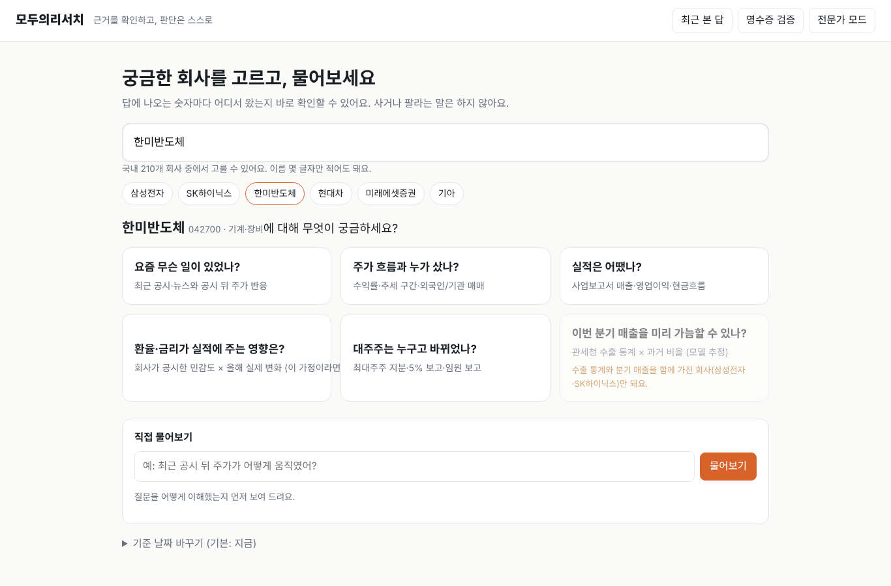
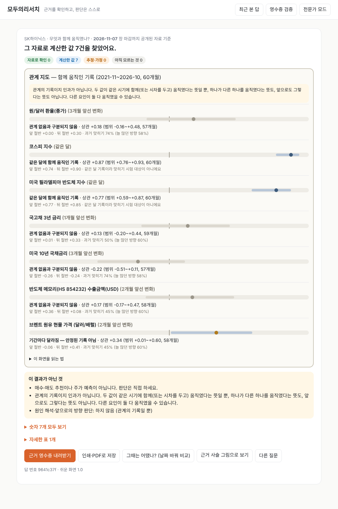
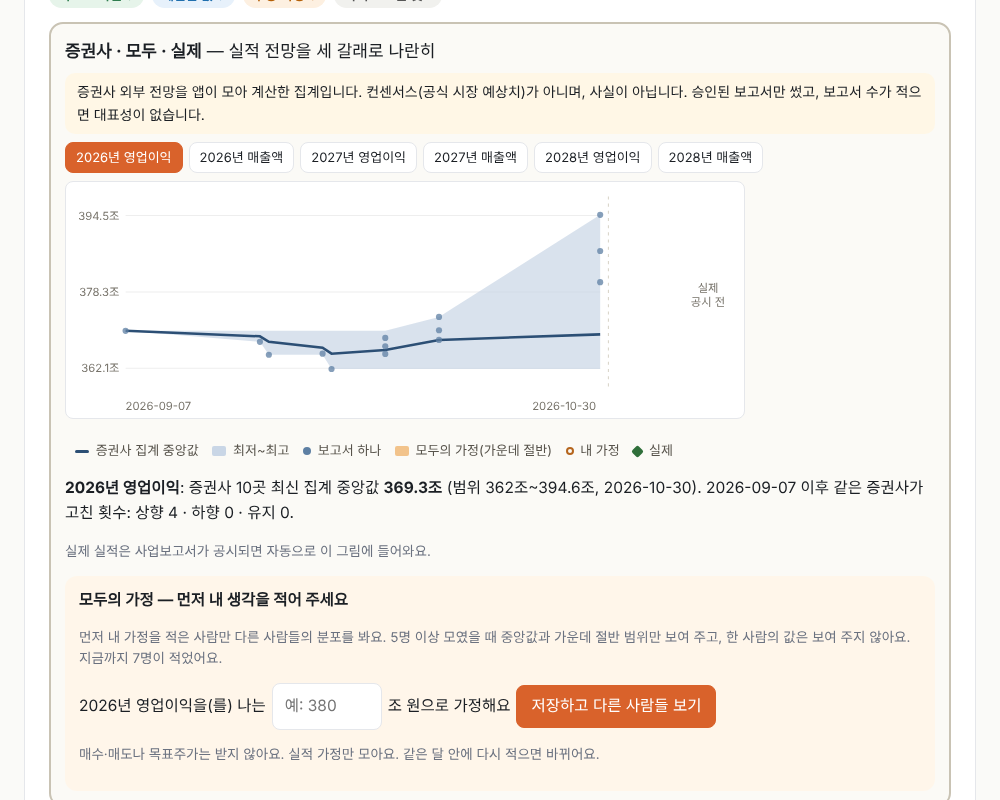
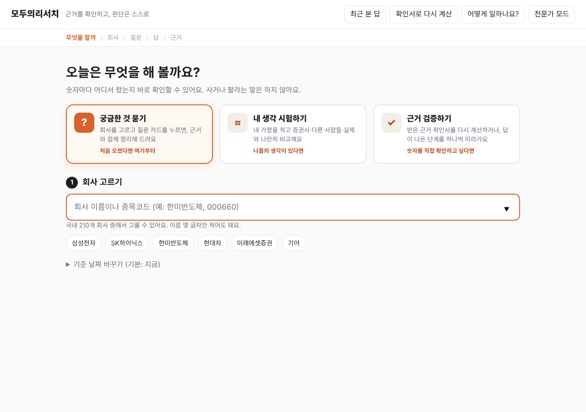
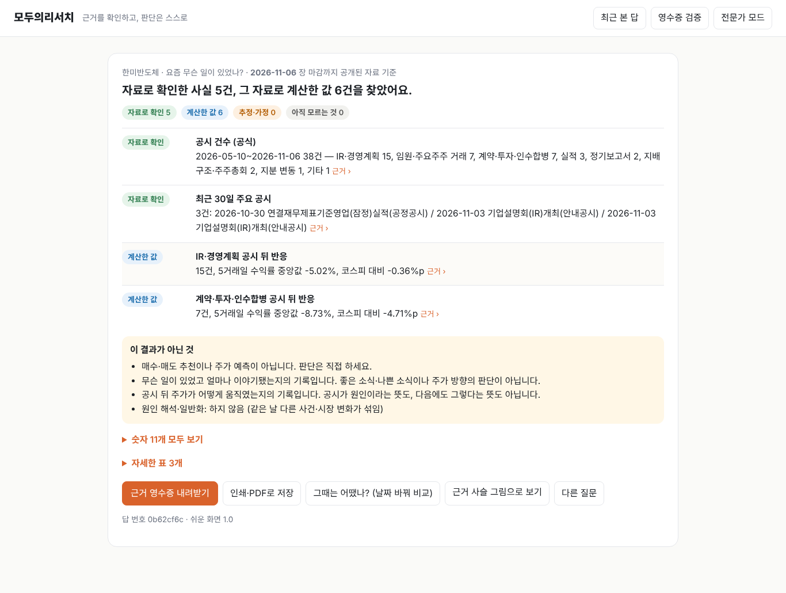
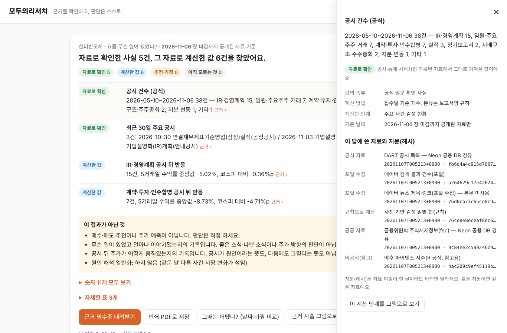
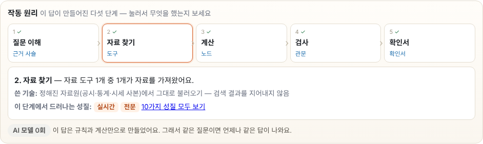
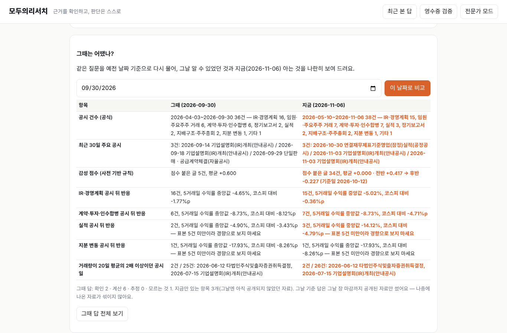
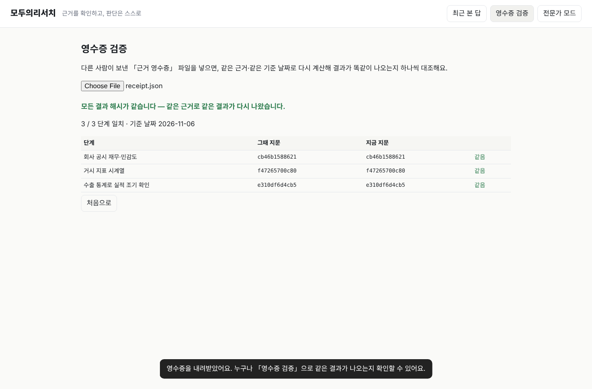

# 모두의리서치 — 근거를 확인하고, 판단은 스스로

회사에 대해 **확인된 사실 · 계산한 값 · 추정 · 아직 모르는 것**을 나눠서 보여 주는 리서치 앱입니다.
숫자마다 어디서 왔는지 바로 열어 볼 수 있고, 매수·매도·목표주가는 말하지 않습니다.

> 이 앱이 지향하는 것: 기관 리서치가 지켜 온 규율(출처를 대고, 그때 알 수 있던 것만 쓰고, 사실과 가정을 섞지 않는 것)을
> 누구나 쓸 수 있게 해서, 각자 스스로 합리적으로 판단하도록 돕는 것.

## 1. 이 앱으로 알 수 있는 것 (실제 예)

| 질문 카드 | 예시 답 |
|---|---|
| 요즘 무슨 일이 있었나? | 한미반도체 최근 6개월 공시 38건을 종류별로 정리하고, 주요 공시 뒤 5거래일 주가 변화를 셈 |
| 주가 흐름과 누가 샀나? | 수익률·변동성·추세 구간, 외국인·기관·개인 순매수와 가격·수급이 엇갈린 날 |
| 실적은 어땠나? | 사업보고서 매출·영업이익·영업현금흐름과 이익률 (210개 회사) |
| 환율·금리가 실적에 주는 영향은? | 회사가 공시한 민감도 × 올해 실제 환율·금리 변화 = 「이 가정이라면」 손익 영향 |
| 대주주는 누구고 바뀌었나? | 최대주주 측 지분 합계와 변화, 5% 대량보유 보고, 임원 보고 건수 |
| 무엇과 함께 움직였나? (관계 지도) | SK하이닉스 60개월: 코스피와는 같은 달에 함께 움직인 기록(상관 +0.87), 원/달러 환율·금리·메모리 수출과는 「관계 없음과 구분되지 않음」. 관계의 기록이지 인과가 아님 |
| 증권사들은 실적을 어떻게 보나? | 삼성전자 2026년 영업이익: 증권사 10곳의 최신 승인 전망 집계 중앙값 369.3조(범위 362.0~394.6조), 9/7 이후 상향 4·하향 0. 컨센서스 아님. 「모두의 가정」과 실제(공시 후)를 같은 그림에 |
| 주가가 실적보다 몇 년 앞서 있나? | 삼성전자 2026-11-05(설정에 우선주 8.15억 주 입력): 주가 ÷ 실적이 받치는 가치(정규화 ROE 기준) → 주가가 실적보다 +1.0년 앞섬(EDI). 같은 날 최근 4분기 ROE 기준 −7.8년, 장부가 기준 +10.9년 — 세 가지 가정을 나란히. 기간 최고점(2026-05-14, +21.1년) 이후 줄어든 몫의 75%는 실적, 25%는 주가 하락. 실적 반영일 사이 구간마다 「실적 주도 / 가격 주도」 국면 기록(N18). 사본의 208개사 모두 가능(DART 분기 자료). 적정주가·목표주가 아님 |
| 이번 분기 매출을 미리 가늠할 수 있나? | SK하이닉스 2026년 3분기: 실적 발표 약 4주 전에 관세청 수출로 97.6~103.6조 원 (실제 104.6조) |

관계 지도는 별도 화면으로 보여 줍니다. 최소 24개월, 기간을 반으로 나눠 다시 확인, 미리 알 수 있던 값만으로 과거 맞히기 시험을 거친 기록만 「기록 있음」이 됩니다.

### 증권사 · 모두 · 실제 (실적 전망 세 갈래)

- **증권사 집계:** 사람이 승인한 보고서 전망만, 그날까지 나온 증권사별 최신 값(120일 넘은 것 제외)의 중앙값·범위. 3곳 미만이면 「추이로 보지 마세요」. 컨센서스가 아니며 목표주가는 다루지 않습니다.
- **모두의 가정:** 먼저 내 가정(조 원)을 적어야 다른 사람들의 분포가 열립니다. 5명 이상일 때 중앙값과 가운데 절반 범위만 보이고, 한 사람의 값은 보이지 않습니다. 매수·매도·목표주가는 받지 않습니다. 같은 달에 다시 적으면 바뀝니다(한 브라우저 = 한 사람).
- **실제:** 사업보고서가 공시되면 「공시 전날까지의 집계 vs 실제」가 자동으로 기록됩니다.
- **보고서 넣기:** 리포트 PDF를 `_sources\broker_reports\inbox` 폴더에 넣고 전문가 모드 「증권사 전망 → 받은 보고서 등록」에서 칸을 확인해 등록 → 「PDF 다시 스캔」 → 「승인」.

## 2. 3분 시작

1. `start.cmd`를 두 번 누릅니다 → 브라우저에 http://127.0.0.1:4395/ 가 열립니다. (처음 한 번은 `setup.cmd`)
2. **하려는 일**을 고릅니다 — 「궁금한 것 묻기」 · 「내 생각 시험하기」 · 「근거 검증하기」.
3. 회사 이름을 몇 글자 적거나 아래 빠른 버튼을 누릅니다.
4. 질문 카드를 누릅니다. 카드는 **지난 일 확인 / 시장의 움직임 / 앞으로에 대한 가정** 세 묶음으로 나뉘어 있고, 보통 2초 안에 답 카드가 나옵니다.

화면 위 「무엇을 할까 › 회사 › 질문 › 답 › 근거」 줄이 지금 어디쯤인지 알려 줍니다. 회사마다 「질문 9개 중 몇 개를 살펴봤는지」도 보여 줍니다.

질문 카드에 없는 것은 「직접 물어보기」에 적으세요. 질문을 어떻게 이해했는지 먼저 보여 주고, 확인을 누르면 조사합니다.

## 3. 답 읽는 법

- **맨 위 문장**은 결론이 아니라 정리입니다: 무엇을 확인했고, 무엇을 계산했고, 무엇을 아직 모르는지.
- **배지 3종**
  - 초록 **자료로 확인** — 공시·통계·시세에서 그대로 가져온 값
  - 파랑 **계산한 값** — 확인된 자료로 정해진 식·규칙에 따라 계산한 값
  - 주황 **추정·가정** — 과거 관계가 유지된다는 가정 등으로 계산한 값 (실제 공시가 나오면 그 값이 우선)
- **숫자를 누르면 근거 서랍**이 열립니다: 계산 방법, 원문 링크, 기준 날짜, 쓴 자료의 지문(해시).
- **이 결과가 아닌 것**, **아직 모르는 것** 칸을 꼭 함께 읽어 주세요.

### 작동 원리 — 이 답은 어떻게 만들어졌나 (쉬운 화면 1.4)

답 카드마다 **질문 이해 → 자료 찾기 → 계산 → 검사 → 확인서** 다섯 단계 띠가 붙습니다. 단계를 누르면 이번 답에서 실제로 한 일(가져온 자료 수, 원문에서 찾은 문단 수, 보류한 계산, 매매·추천 표현 검사 결과)과 쓴 기술(근거 사슬·조립 에이전트·원문 검색(RAG)·근거 관문·확인서)이 나옵니다. 이 내용은 실행 기록에서만 만들며, **AI 모델을 몇 번 불렀는지**도 함께 보여 줍니다(지금 쉬운 화면은 0회 — 규칙과 계산만).

답 아래 **다음 걸음**에서 이어서 볼 질문, 「내 가정 적어 보기」, 「이 답 검증하기」로 바로 넘어갈 수 있습니다. 위쪽 「작동 원리 공개」에는 다섯 단계 설명, 이 앱의 10가지 성질을 어디서 겪는지, 쉬운 말 풀이가 있습니다.

## 4. 그때는 어땠나? — 날짜 바꿔 비교

답 카드의 「그때는 어땠나?」에서 예전 날짜를 고르면, 그날 장 마감까지 공개된 자료만으로 같은 질문에 다시 답하고 지금과 나란히 보여 줍니다.
나중에 나온 자료가 섞이지 않기 때문에 「그때 알 수 있었던 것」을 그대로 볼 수 있습니다. 처음 화면의 「기준 날짜 바꾸기」로 처음부터 예전 날짜로 물을 수도 있습니다.

## 5. 근거 확인서 — 누구나 다시 계산해 확인

「근거 확인서 내려받기」는 답을 만든 단계·기준 날짜·결과 지문을 담은 파일(.json)을 줍니다.
다른 사람이 같은 앱·같은 자료에서 「확인서로 다시 계산」에 넣으면 같은 계산을 다시 해서 지문을 하나씩 대조합니다.
확인서를 한 글자라도 고치면 검증에서 바로 드러납니다. 인쇄가 필요하면 「인쇄·PDF로 저장」을 쓰세요.
근거 확인서는 「이 근거로 계산하면 이 결과가 나온다」는 것을 확인해 줄 뿐, 결과가 옳다거나 투자해도 된다는 보증이 아닙니다. 근거 서랍의 「출처근거」 칸에서 답에 쓴 자료와 지문을 볼 수 있습니다.

## 6. 이 앱이 하지 않는 것

- 매수·매도 추천, 목표주가, 주가 예측
- 뉴스 본문 해석 (뉴스는 제목·링크·날짜만, 감성 점수는 단어 사전 규칙 값)
- 원인 단정 (예: 「공시 때문에 올랐다」) — 같은 기간 다른 사건이 섞이기 때문
- 숫자를 그럴듯하게 채우기 — 근거가 모자라면 「보류」하고 「아직 모르는 것」에 이유를 적습니다

## 7. 자료 새로 받기

회사 자료는 PC에 고정한 사본에서만 읽습니다(앱은 DB에 직접 접속하지 않습니다).

1. Neon DB 주소를 **복사만** 합니다. (대화창·파일에 붙이지 마세요)
2. `_tools\neon_snapshot\run-neon-snapshot.cmd`를 실행합니다. 몇 분 뒤 「완료」가 뜨면 끝입니다.
3. 앱을 다시 시작(`stop.cmd` → `start.cmd`)합니다.

### 증권사 보고서 일괄 받기 (v0.21)

1. `_tools\broker_fetch\run-bulk-3m.cmd`를 실행합니다(기간은 파일 안 FROM/TO). 네이버페이증권 기업분석 목록에서 분석 대상 종목의 PDF를 받아 `_sources\broker_reports\inbox`에 넣고, 이어서 등록 → 스캔 → **자동 승인 규칙 v1**을 적용합니다. 중간에 꺼도 다시 실행하면 이어서 합니다.
2. 자동 승인 규칙 v1: 해시 일치·정상 스캔(R1) · 대상 종목(R2) · 기간 안(R3) · **표의 과거 실적 열이 공시 원문과 일치(R4)** · 상식 범위(R5) · 전망 연도 +3년 이내(R6). 하나라도 못 맞추면 '제안'으로 남아 전문가 모드에서 사람이 봅니다. 사람이 이미 결정한 값은 건드리지 않습니다.
3. `data\broker_auto\(시각)\sample30.csv`의 30건을 PDF 원문과 대조합니다. 틀림이 2건 이하면 그대로 쓰고, 넘으면 `python -m mrn.broker_auto revert`로 자동 승인만 한 번에 되돌립니다. 현황: `python -m mrn.broker_auto status`.
4. 받은 PDF는 연구용 내부 보관 전용이며 재배포하지 않습니다. 앱 화면에는 숫자 요약만 나옵니다.

**v0.22 바뀐 점**
- 이어 스캔: PDF 글자를 한 번만 읽어 `_sources\broker_reports\_textcache`에 둡니다. 1,500건 다시 스캔이 1~2분.
- 자동 승인 규칙 v2: R7 행 이름 정확 일치('조정영업이익' 등은 사람 확인) · R8 같은 보고서 안 다른 표와 1% 넘게 다르면 사람 확인 · 연도가 겹치는 비교표(변경 전/후·컨센서스)는 읽지 않음.
- 미리 보기: `python -m mrn.broker_auto run --from … --to … --dry-run` → 사본으로 돌려 `changes.csv`(바뀌는 값)만 만듭니다.
- 파일 이름: `날짜_종목코드_회사명_증권사_해시8.pdf`. 옛 이름은 manifest의 「이전 파일명」에 남고, 저장된 워크플로가 옛 이름을 가리켜도 그대로 찾습니다. (`python -m mrn.broker_auto rename` 계획 / `--apply` 실행)
- 영문이 섞인 신규 종목코드(예: 0126Z0)도 등록됩니다.
- 시험은 `_sources\broker_reports_fixture`(원래 보고서 15건)로 돕니다.
- EDI 카드 「증권사 전망이 맞다면」: 영업이익 전망을 순이익으로 바꾸는 비율을 최근 4분기 → 최근 12분기 → 기본 가정 0.76 순으로 씁니다(적자 기업도 계산, 어느 비율을 썼는지 답에 표시). 1조 미만 금액은 억원으로 표시.

### 분기 전망 · 순이익 전망 · 분기 전망 성적표 (v0.24)

- **넣는 방법:** `stop.cmd` → `apply-quarter.cmd` → `start.cmd`. 받아 둔 보고서(글자 캐시)에서 ① 분기 매출액·영업이익 전망 ② 연간 연결 당기순이익 전망을 읽어 **새 표**(`broker_forecasts_v2`)에 넣습니다. 기존 연간 전망 표는 건드리지 않습니다. 되돌리기: `.venv\Scripts\python.exe -X utf8 -m mrn.broker_quarter revert`(자동 승인분만 지움), 현황: `… status`, 미리 보기만: `… preview`.
- **자동 승인 규칙 q1:** 표의 실적 분기 열(꼬리표 A·없음) 2개 이상이 DART 정기보고서 분기값과 모두 맞는 단위일 때만 승인, 아니면 「제안」으로 남깁니다. 분기 열 꼬리표 E·F만 전망으로 쓰고 P(잠정 실적)는 쓰지 않습니다. 순이익은 연간 표의 과거 열이 DART 연결 당기순이익과 맞을 때만 승인하고, 「당기순이익」처럼 분명한 행 이름을 「순이익」보다 먼저 고릅니다.
- **표본 대조(2026-11-09):** 보고서 1,487건 → 분기 전망 3,702건(157개사)·순이익 전망 2,920건(163개사) 자동 승인 후보. 무작위 30건씩 PDF와 대조해 분기 30/30, 순이익 30/30 일치(1건은 보고서 안 표끼리 1 차이 — 반올림).
- **분기 전망 성적표:** 「증권사들은 실적을 어떻게 보나?」 답 아래. 증권사마다 **실적이 처음 알려진 날(첫 잠정실적 공시일과 정기보고서 접수일 중 이른 날) 전날까지** 낸 마지막 분기 전망과 DART 분기 실제값을 견줍니다. 실제가 아직 공시 전이면 「공시 전」으로 두고, 정기보고서가 사본에 들어오면 자동으로 채점합니다. 2026년 3분기는 3분기보고서가 사본에 들어온 뒤 채점됩니다.
- **EDI 「증권사 전망이 맞다면」:** 그 연도의 순이익 전망이 증권사 3곳 이상 승인돼 있으면 영업이익 × 비율 환산 대신 순이익 전망 중앙값을 바로 씁니다(답에 「영업이익 환산 아님」 표시).
- 지배주주순이익은 공시 사본에 대조할 값이 거의 없어(약 13개사) 아직 넣지 않습니다.

### AI 길잡이 (v0.26, 기본 꺼짐)

「직접 물어보기」에서 앱이 질문을 다 알아듣지 못하면 **「가까운 질문 찾아보기」**가 나옵니다(규칙으로 찾음, AI 아님). PC에 AI 모델을 연결하고 「AI 길잡이 쓰기」를 켜면, 같은 자리에서 **AI 길잡이가 질문을 앱이 알아듣는 말로 바꿔** 제안합니다.

- **켜는 방법:** 앱 폴더 `local-env.cmd`에 `set MODU_NODES_LLM_URL=http://127.0.0.1:11434/v1`, `set MODU_NODES_LLM_MODEL=모델이름`(예: Ollama) → `stop.cmd` → `start.cmd` → 「직접 물어보기」 아래 「AI 길잡이 쓰기」 체크. 로컬 주소면 질문이 PC 밖으로 나가지 않습니다.
- **AI 길잡이가 하는 일:** 질문을 앱의 말로 바꾸기, 가장 가까운 질문 카드 고르기, 이유 한 문장. **숫자·사실·전망·투자 판단은 만들지 않습니다.**
- **안전장치:** 모델 글에 숫자(질문에 있던 연도만 예외)나 매매·목표주가 표현이 있으면 버리고, 고른 카드는 등록부와 대조하며, 바꾼 질문은 규칙 엔진이 다시 읽어 알아들을 때만 보여 줍니다. 실행은 언제나 사용자가 누릅니다. 「사도 돼?」 같은 판단 질문은 모델을 부르지 않고 판단 재료 질문으로 안내합니다.
- **표시:** 제안 상자에 「AI 작성 · 모델 이름 · 호출 횟수」, 그 질문으로 실행한 답의 「작동 원리」에 「AI 모델 1회 — 질문 바꾸기에만」. 감사 기록에는 질문 원문 대신 지문만 남깁니다.

## 8. 자주 묻는 것

| 증상 | 해결 |
|---|---|
| 화면이 예전 그대로 | 브라우저에서 Ctrl+F5 |
| 카드가 흐리게 나오고 「자료가 없어요」 | 그 회사는 그 자료가 사본에 없음. 전문가 모드의 「근거 지도」에서 회사별 자료를 확인 |
| 「보류」가 많음 | 기준 날짜가 너무 이르거나 사본이 오래됨. 날짜를 지우고(지금) 다시 묻거나 자료를 새로 받기 |
| 다시 계산 결과가 「다름」 | 자료(사본)나 앱 버전이 확인서를 만들 때와 다름 |

## 9. 전문가 모드

오른쪽 위 「전문가 모드」(또는 답 카드의 「근거 사슬 그림으로 보기」)는 계산 단계를 그림으로 직접 잇고 고치는 화면입니다.
값의 종류 8가지, 증권사 전망 승인·비교, 표현 검사, 에이전트 실행 등은 [전문가 모드 설명서](docs/EXPERT_GUIDE.md)를 보세요.

## 10. 버전

| 화면 | 주소 | 버전 |
|---|---|---|
| 쉬운 화면 (기본) | `/` | 쉬운 화면 1.4 (앱 v0.24) |
| 전문가 모드 | `/expert` | 노드 캔버스 (v0.14 화면 유지) |

앱 버전마다 `_releases\v…\`에 전체 묶음·해시·변경 내용이 보관됩니다. 화면을 바꿔도 계산 단계와 시험(129개)은 그대로입니다.

## 공유용 페이지 · 가설 일지 · 배우는 길 (v0.32)

- **공유용 페이지 내려받기**(답 아래): 답·숫자·원문 링크·작동 원리·자료 지문을 담은 한 장짜리 `.html`. 받는 사람은 설치 없이 아무 브라우저로 열어 읽고, 이 파일을 그대로 「확인서로 다시 계산해 보기」에 넣으면 같은 근거로 다시 계산해 대조합니다(근거 확인서가 파일 안에 들어 있음). 외부 요청 없음.
- **가설 일지**(위쪽): 「증권사들은 실적을 어떻게 보나?」에서 적은 내 가정을 모아, 적은 날의 증권사 집계·모두의 가정과 나란히 보여 주고 실적이 공시되면 저절로 채점합니다(공시 전에 적은 것만). 「왜 이렇게 봤나」 메모는 나만 봅니다.
- **배우는 길**(위쪽): 출처·시점·사실과 가정 구분·재현을 익히는 과제 9개(3단계). 해 본 일은 저절로 체크됩니다.
- 새 표 두 개(hypothesis_notes, learn_marks)만 더했고 기존 표는 읽기만 합니다. AI 모델은 쓰지 않습니다.
